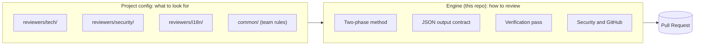
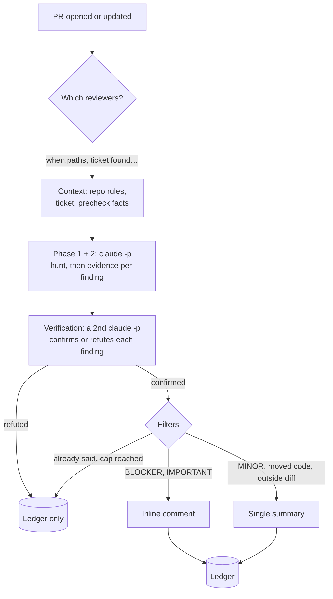
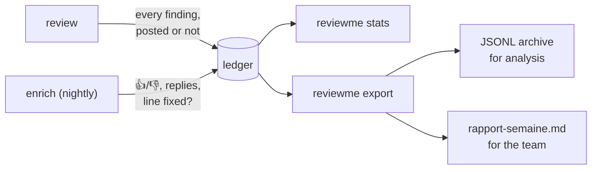

# ReviewMe

[🇫🇷 Français](README.md) · 🇬🇧 English

**An AI code review bot for GitHub Pull Requests.** It reads the diff and the repository,
then posts **line-by-line** comments, like a human reviewer. Several specialised
reviewers can run on the same PR: technical, security, translations, ticket criteria…

```text
src/orders/service.py, line 42
[IMPORTANT] `charge()` is called without `await`: the payment runs in the background and
any error is lost. Add `await` and let the exception propagate.
```

---

## The idea: method in the engine, knowledge in the config

ReviewMe keeps two things apart:

- **the engine (this repository)** knows *how* to review: the method, the output format,
  the verification pass, security, talking to GitHub. It is the same for every project;
- **a reviewer (a config folder)** knows *what* to look for in *this* project: its persona,
  its rules, when it runs. A team writes as many as it needs.



A project combines two kinds of reviewers.

### Core reviewers: enable them by name

Shipped with the engine (`config/templates/reviewers/`), they follow its updates. Enable
them in the project's `project.toml`; removing a name disables it.

```toml
# .reviewme/projects/shop/project.toml
[reviewers]
core = ["tech", "conseil"]
```

| Name | Role | Output | Requires |
|---|---|---|---|
| `tech` | bugs, logic, security, repository conventions | inline | — |
| `us` | are the ticket's acceptance criteria covered? | one comment, silent when all are covered | Jira (`JIRA_BASE_URL`, `JIRA_EMAIL`, `JIRA_API_TOKEN`) |
| `i18n` | missing or doubtful translations | inline and summary | translation files in the PR (`*.strings`, `values*/strings.xml`…) |
| `conseil` | what a human must check themselves on this PR | one comment, silent when nothing applies | — |

### Custom reviewers: a folder in the project

For what is specific to **your** code, a reviewer is a folder under
`.reviewme/projects/<project>/reviewers/<name>/`, in the reviewed repository (or in a
separate config repository, via `REVIEWME_CONFIG_HOME`). The name is free; a folder named
after a core reviewer replaces it for that project.

```text
.reviewme/projects/shop/
├── project.toml                 project settings (optional)
├── common/
│   └── regles-terrain.md        team rules, shared by every reviewer
└── reviewers/
    └── security/
        ├── reviewer.toml        when it runs, what it reads
        └── system.md            its persona: what it looks for in THIS project
```

```toml
# reviewers/security/reviewer.toml
output_mode = "inline"                 # inline | global | mixed
priority    = 10

[when]                                 # only runs when these files change
paths = ["src/api/**", "src/auth/**"]

[context]                              # read from the reviewed repo, never copied here
read = ["docs/security.md"]

```

```markdown
<!-- reviewers/security/system.md -->
# Shop security reviewer
You look for: routes without access control, SQL built by string concatenation,
hard-coded secrets, customer data written to logs. `@public` decorators are intentional.
```

The engine adds the method, the output format and the repository's instruction files
(`CLAUDE.md`, `AGENTS.md`, `.claude/rules/`) on its own. The persona stays short.

---

## The life of a PR



- **Each reviewer is an independent, read-only `claude -p`** (`Read`, `Grep`, `Glob`,
  `git log/show/diff`), run in parallel.
- **Verification replaces the confidence threshold as the main filter.** A second call
  receives the findings and must cite the line that proves each one; anything unproven
  is not posted.
- **No duplicates across commits**: every comment carries a fingerprint of its line. When
  the line changes, the bot replies in the thread instead of posting again.

---

## Start in 5 minutes

```sh
git clone https://github.com/AccorECOM/reviewme.git && cd reviewme
uv sync
npm install -g @anthropic-ai/claude-code
cp .env.example .env            # GITHUB_TOKEN, GITHUB_REPO, REPO_PATH

uv run reviewme review --repo my-org/my-app --pr 123 --dry-run
```

`--dry-run` computes everything and prints what **would** be posted, without writing to
GitHub. Without `PROJECT`, a single generic reviewer runs (simple mode). For a real project, the
shortest path is a `project.toml` enabling core reviewers (see above):

```sh
mkdir -p .reviewme/projects/my-app
printf '[reviewers]\ncore = ["tech", "conseil"]\n' > .reviewme/projects/my-app/project.toml
REVIEWME_CONFIG_HOME=$PWD/.reviewme PROJECT=my-app uv run reviewme projects
```

To start from an editable copy of a core reviewer: `reviewme init-project my-app --reviewers tech`.

In CI: a GitHub Actions example lives in [`deploy/github-actions/`](deploy/github-actions/),
a Bitrise example in [`deploy/bitrise-step.md`](deploy/bitrise-step.md).

---

## What lands on the PR

| Finding | Where | Why |
|---|---|---|
| `BLOCKER`, `IMPORTANT` on code introduced by the PR | inline | worth the developer's attention |
| `MINOR` | summary | useful, but not worth a notification per line |
| on code the PR only **moved** | summary, tagged | not a defect of this PR |
| outside the diff lines | summary | GitHub rejects comments outside the diff |
| not confirmed by verification | nowhere (ledger) | a false positive costs the team's trust |
| **💡 Review tip** (`conseil` reviewer): something a human must check themselves (call order changed, file placed outside its usual folder…) | one comment | only when it applies, anchored in files of the PR; 3 at most |
| clean PR | nothing | silence beats a "LGTM" |

The bot only posts comments: never an approval or a change request.

---

## Measuring whether it helps



The ledger keeps **every** finding with its fate and confidence, including the dropped
ones, so you can answer "is this threshold costing us real bugs?". `reviewme stats` shows,
per reviewer, the share of findings acted upon, approved and contested, and calibration by
confidence band. The schema is in [`docs/registre-schema.md`](docs/registre-schema.md)
(French). Finding text is only stored when the project asks for it
(`[ledger] include_text = true`).

---

## Security

The diff, the ticket and the comments are written by third parties: they are **data**,
never instructions.

- **Read-only tools**, allowlist locked in code: no `Write`, no sub-agents, never
  `--dangerously-skip-permissions`. Hooks and MCP servers of the reviewed repo are not
  loaded.
- **A PR cannot change its own review**: when the config lives in the reviewed repo
  (`.reviewme/`), it is read from the base branch, as are `CLAUDE.md` and `.claude/rules/`.
  To try a new reviewer inside its own PR, start a build by hand with
  `REVIEWME_CONFIG_SOURCE=pr`.
- Secrets and absolute paths are scrubbed before posting; the webhook rejects unsigned
  requests (HMAC).
- A `precheck` is code supplied by the project: review it like code.

---

## Quick reference

| Command | Purpose |
|---|---|
| `reviewme review --repo O/R --pr N` | review one PR (`--dry-run`, `--force`) |
| `reviewme init-project <name> --reviewers tech,us` | create a project from the skeleton |
| `reviewme projects` | list projects and their reviewers |
| `reviewme enrich --since 14d` | record what happened to posted findings (nightly) |
| `reviewme export --since 7d --out DIR` | analysis archive and readable report |
| `reviewme stats [--html F]` | counters and quality block |
| `reviewme feedback --pr N` | developer replies, as rules to review |
| `reviewme-webhook` · `reviewme-poll` · `reviewme-web` | webhook server, poll loop, dashboard |

| Variable | Purpose |
|---|---|
| `GITHUB_TOKEN` (or `GITHUB_APP_ID` + key) | GitHub access |
| `REPO_PATH` | local clone of the reviewed repo |
| `REVIEWME_CONFIG_HOME`, `PROJECT` | where the config lives, which project |
| `CONFIDENCE_THRESHOLD` | confidence threshold (default 80) |
| `MAX_COMMENTS_PER_PR` | comment cap per PR (default 10) |
| `REVIEWME_INLINE_MIN_SEVERITY` | lowest severity posted inline (default `IMPORTANT`) |
| `REVIEWME_VERIFY` | `0` turns verification off |
| `REVIEWME_CONFIG_SOURCE` | `base` (default) or `pr` |
| `REVIEWME_FAKE`, `REVIEWME_DEBUG` | no model call; verbose log |
| `ANTHROPIC_BASE_URL`, `CLAUDE_MODEL` | LLM gateway, model |

Every key, commented (French): [`.env.example`](.env.example). Every `reviewer.toml`
option: [`docs/reviewme.html`](docs/reviewme.html). Known limits: [`ROADMAP.md`](ROADMAP.md).

## Tests

```sh
uv run --with pytest pytest tests/
uvx ruff check .
```
