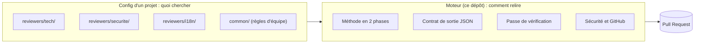
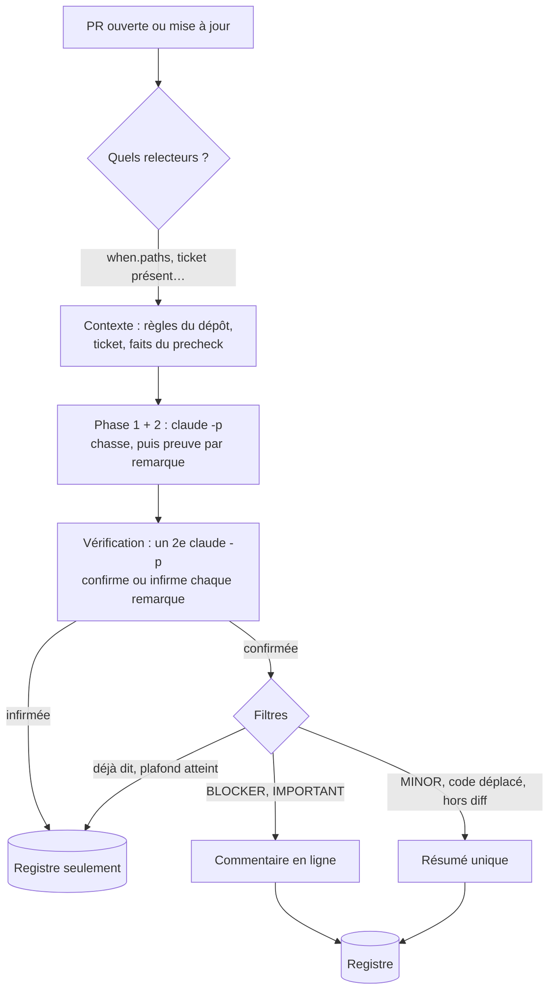
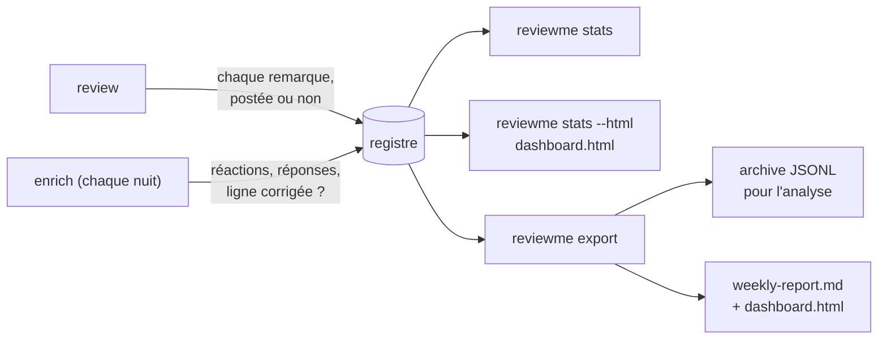

# ReviewMe

[English](README.md) · **Français**

**Un bot de code review par IA pour les Pull Requests GitHub.** Il lit le diff et le
dépôt, puis poste des commentaires **ligne par ligne**, comme un relecteur humain.
Plusieurs relecteurs spécialisés peuvent tourner sur la même PR : technique, sécurité,
traductions, critères du ticket…

```text
src/orders/service.py, ligne 42
[IMPORTANT] `charge()` est appelée sans `await` : le paiement part en tâche de fond et
l'erreur éventuelle est perdue. Ajouter `await` et laisser l'exception remonter.
```

## Installation

```sh
uv sync && npm install -g @anthropic-ai/claude-code
cp .env.example .env            # GITHUB_TOKEN, GITHUB_REPO, REPO_PATH
uv run reviewme review --repo mon-org/mon-app --pr 123 --dry-run
```

Prérequis : Python 3.13, [uv](https://docs.astral.sh/uv/), la CLI
[Claude Code](https://docs.anthropic.com/en/docs/claude-code) dans le `PATH`, et un token
GitHub fine-grained limité au dépôt relu. `--dry-run` affiche ce qui serait posté sans rien
écrire sur GitHub ; `REVIEWME_FAKE=1` se passe complètement du modèle. Le parcours complet
est dans [Démarrer en 5 minutes](#démarrer-en-5-minutes).

---

## Le principe : la méthode dans le moteur, la connaissance dans la config

ReviewMe sépare deux choses :

- **le moteur (ce dépôt)** sait *comment* relire : la méthode, le format de sortie, la
  vérification, la sécurité, le dialogue avec GitHub. Il est le même pour tous les projets ;
- **un relecteur (un dossier de config)** sait *quoi* chercher dans *ce* projet : sa
  persona, ses règles, quand il se déclenche. Une équipe en écrit autant qu'elle veut.



Un projet combine deux sortes de relecteurs, qui s'activent différemment :

| | Relecteur du core | Relecteur custom |
|---|---|---|
| Où il est défini | dans le moteur | dans votre dépôt, `reviewers/<nom>/` |
| Comment l'activer | son nom dans `core = [...]` du `project.toml` | son dossier existe : rien d'autre à déclarer |
| Comment le couper | retirer son nom de la liste | `enabled = false` dans son `reviewer.toml` |
| Mises à jour | suit le moteur | les vôtres |

Exemple complet d'un projet qui utilise les deux :

```text
.reviewme/projects/boutique/
├── project.toml              [reviewers] core = ["tech", "advisor"]
└── reviewers/
    └── securite/             relecteur custom, actif parce que le dossier existe
        ├── reviewer.toml
        └── system.md
```

Trois relecteurs tournent sur ses PR : `tech` et `advisor` (core), `securite` (custom).

### Relecteurs du core : à activer par leur nom

Fournis par le moteur (`config/templates/reviewers/`), ils suivent ses mises à jour. On les
active dans le `project.toml` du projet ; retirer un nom les désactive.

```toml
# .reviewme/projects/boutique/project.toml
[reviewers]
core = ["tech", "advisor"]
```

| Nom | Rôle | Sortie | Prérequis |
|---|---|---|---|
| `tech` | bugs, logique, sécurité, conventions du dépôt | en ligne | — |
| `us` | les critères d'acceptation du ticket sont-ils couverts ? | un commentaire, muet si tout est couvert | Jira (`JIRA_BASE_URL`, `JIRA_EMAIL`, `JIRA_API_TOKEN`) |
| `i18n` | traductions manquantes ou douteuses | en ligne et résumé | fichiers de traduction dans la PR (`*.strings`, `values*/strings.xml`…) |
| `advisor` | ce qu'un humain doit valider lui-même sur cette PR | un commentaire, muet si rien d'applicable | — |

**Les adapter sans les copier** : le projet peut indiquer à un relecteur du core où est
sa doc, quand tourner et ce qu'il doit savoir. Le reste (méthode, sortie, vérification)
reste celui du moteur.

```toml
[reviewers.tech]
read = ["Documentation/ARCHITECTURE.md", "Documentation/"]   # ajouté à sa lecture
paths = ["src/**"]                                            # quand il tourne
instructions = "Les services métier sont dans src/services ; pas d'appel réseau dans les vues."
# model = "…"   max_turns = 50   priority = 10   enabled = false
```

**Laisser une IA le faire** : le skill [`skills/reviewme-create-reviewer`](skills/reviewme-create-reviewer/SKILL.md)
guide Claude Code pour explorer le dépôt, choisir entre adapter un relecteur du core et en
créer un, écrire une persona courte et valider la config. Copiez-le dans `.claude/skills/`
du projet, puis demandez par exemple « ajoute un relecteur qui vérifie nos migrations ».

### Relecteurs custom : un dossier dans le projet

Pour ce qui est propre à **votre** code, un relecteur est un dossier sous
`.reviewme/projects/<projet>/reviewers/<nom>/`, dans le dépôt relu (ou dans un dépôt de
config à part, via `REVIEWME_CONFIG_HOME`). Son nom est libre ; un dossier qui porte le nom
d'un relecteur du core le remplace pour ce projet.

```text
.reviewme/projects/boutique/
├── project.toml                 réglages du projet (optionnel)
├── common/
│   └── team-rules.md            règles de l'équipe, communes à tous les relecteurs
└── reviewers/
    └── securite/
        ├── reviewer.toml        quand il tourne, ce qu'il lit
        └── system.md            sa persona : ce qu'il cherche dans CE projet
```

```toml
# reviewers/securite/reviewer.toml
output_mode = "inline"                 # inline | global | mixed
priority    = 10

[when]                                 # ne tourne que si ces fichiers changent
paths = ["src/api/**", "src/auth/**"]

[context]                              # lus dans le dépôt relu, jamais recopiés ici
read = ["docs/securite.md"]

```

```markdown
<!-- reviewers/securite/system.md -->
# Relecteur sécurité de la boutique
Tu cherches : routes sans contrôle d'accès, SQL construit par concaténation, secrets en
dur, données client écrites dans les logs. Les décorateurs `@public` sont volontaires.
```

Le moteur ajoute tout seul la méthode, le format de sortie et les fichiers d'instructions
du dépôt (`CLAUDE.md`, `AGENTS.md`, `.claude/rules/`). La persona reste courte.

---

## Le parcours d'une PR



- **Chaque relecteur est un `claude -p` indépendant**, en lecture seule (`Read`, `Grep`,
  `Glob`, `git log/show/diff`), lancé en parallèle.
- **La vérification remplace le seuil de confiance comme filtre principal.** Un second
  appel reçoit les remarques et doit citer la ligne qui prouve chacune ; ce qui n'est pas
  prouvé n'est pas posté.
- **Pas de doublon d'un commit à l'autre** : chaque commentaire porte une empreinte de sa
  ligne. Si la ligne change, le bot répond dans le fil au lieu de reposter.

---

## Démarrer en 5 minutes

```sh
git clone https://github.com/AccorECOM/reviewme.git && cd reviewme
uv sync
npm install -g @anthropic-ai/claude-code
cp .env.example .env            # GITHUB_TOKEN, GITHUB_REPO, REPO_PATH

uv run reviewme review --repo mon-org/mon-app --pr 123 --dry-run
```

`--dry-run` calcule tout et affiche ce qui **serait** posté, sans rien écrire sur GitHub.
Sans `PROJECT`, un seul relecteur générique tourne (mode simple). Pour un vrai projet, le
plus court est un `project.toml` qui active des relecteurs du core (voir plus haut) :

```sh
mkdir -p .reviewme/projects/mon-app
printf '[reviewers]\ncore = ["tech", "advisor"]\n' > .reviewme/projects/mon-app/project.toml
REVIEWME_CONFIG_HOME=$PWD/.reviewme PROJECT=mon-app uv run reviewme projects
```

Pour partir d'une copie modifiable d'un relecteur du core :
`reviewme init-project mon-app --reviewers tech`.

En CI : un exemple GitHub Actions est dans [`deploy/github-actions/`](deploy/github-actions/),
un exemple Bitrise dans [`deploy/bitrise-step.md`](deploy/bitrise-step.md).

---

## Le lancer sur sa machine (mode watch)

Pas besoin de CI : `reviewme watch` regarde les PR ouvertes d'un dépôt toutes les
quelques minutes et relit chaque PR, à nouveau après chaque push. Il appelle la CLI Claude Code telle
qu'elle est configurée sur la machine : ReviewMe ne décide pas comment la CLI accède au
modèle. Si `claude -p "bonjour"` marche dans ce terminal, watch marche.

```sh
git clone git@github.com:my-org/my-app.git ~/src/my-app
uv run reviewme watch --repo my-org/my-app --repo-path ~/src/my-app --every 10m
```

Commencez par `--once --dry-run` : un seul tour, rien n'est posté, le log dit quelles PR
seraient relues et pourquoi les autres sont laissées de côté.

| Quelles PR | Par défaut | Pour changer |
|---|---|---|
| PR ouvertes | toutes | `--label review-me` : seulement celles qui portent ce label |
| PR avec le label `no-ai-review` | ignorées | `--skip-label NOM` (`""` le désactive, ou `REVIEWME_SKIP_LABEL`) |
| drafts | ignorées | `--include-drafts` |
| PR venant d'un fork | ignorées | `--include-forks` (auteurs extérieurs au dépôt) |
| commit déjà relu | pas relu à nouveau | un nouveau push est relu |
| commit dont la relecture a échoué | pas retenté | un nouveau push est retenté |

Ce qu'il fait :

- **Votre clone n'est jamais touché.** Chaque PR est extraite dans un `git worktree`
  temporaire, au commit de tête, à côté du clone, puis supprimée. Le travail non commité
  et la branche courante restent tels quels. `--repo-path` (ou `REPO_PATH`) doit être un
  clone de `--repo` : sinon, refus.
- **La même relecture qu'en CI** : mêmes relecteurs, même config (toujours lue sur la
  branche de base), même dédoublonnage. Lancer watch à côté d'un job CI ne double pas
  les commentaires.
- **Une PR à la fois** par défaut (`--parallel N` pour changer), toutes les 10 minutes
  (`--every 90s|10m|1h`, ou `POLL_INTERVAL` ; minimum 1 minute).
- **Limites d'usage** : quand le quota du modèle est atteint, le commit n'est *pas*
  marqué en échec. La boucle attend l'heure de reset donnée par la CLI (sinon elle double
  l'attente, jusqu'à une heure), puis reprend là où elle s'était arrêtée.
- Les commentaires sont postés avec l'identité de `GITHUB_TOKEN` : votre propre compte si
  c'est votre token personnel, un bot si c'est une GitHub App ou le token d'un compte bot.
- Un seul watch par dépôt à la fois (verrou dans `data/`). `--dashboard` sert le tableau
  de bord en lecture seule sur `127.0.0.1:8420`. Arrêt par Ctrl-C : la relecture en
  cours se termine d'abord.

Pour le laisser tourner : un multiplexeur de terminal, ou `--once` depuis `cron`/`launchd`.
`reviewme-poll` marche toujours : c'est la même boucle, réglée par le `.env` seul
(`REVIEW_LABEL`, `REVIEW_ALL_PRS`, `POLL_INTERVAL`).

---

## Ce qui arrive sur la PR

| Remarque | Où | Pourquoi |
|---|---|---|
| `BLOCKER`, `IMPORTANT` sur du code introduit par la PR | en ligne | c'est ce qui mérite l'attention du dev |
| `MINOR` | résumé | utile, mais pas au prix d'une notification par ligne |
| sur du code seulement **déplacé** par la PR | résumé, tagué | ce n'est pas un défaut de la PR |
| hors des lignes du diff | résumé | GitHub refuse un commentaire hors diff |
| non confirmée par la vérification | nulle part (registre) | un faux positif coûte la confiance de l'équipe |
| **💡 Conseil pour la relecture** (relecteur `advisor`) : un point qu'un humain doit valider lui-même (ordre d'appels modifié, fichier rangé hors de son dossier habituel…) | un commentaire | seulement s'il est applicable, ancré dans des fichiers de la PR ; 3 au plus |
| PR propre | rien | le silence vaut mieux qu'un « RAS » |

La langue des remarques postées et des titres du bot se règle par projet dans
`project.toml` : `[review] language = "fr"` (défaut `en`).

### Modèle et score sur les commentaires

Deux interrupteurs du `project.toml`, désactivés par défaut, ajoutent une petite ligne
sous chaque remarque. Ils servent à évaluer le bot (quel modèle, quels réglages, quelle
assurance), pas à la lecture quotidienne du développeur.

```toml
[review]
show_model = true   # sur quel modèle le relecteur a tourné
show_score = true   # le score de chaque remarque
```

`show_model` affiche **deux noms**, parce qu'ils peuvent différer :

- **configuré** : le nom demandé par votre installation, le `model` du relecteur, sinon
  `CLAUDE_MODEL`, sinon `ANTHROPIC_MODEL` (« défaut du CLI » si aucun n'est défini).
  Derrière une passerelle maison, ce peut être un alias comme `SuperLLM` ;
- **a répondu** : le modèle que déclare la réponse de l'API, lu dans l'enveloppe du CLI
  (`modelUsage` ; si le CLI en a utilisé plusieurs, celui qui a coûté le plus). C'est là
  qu'on voit que `SuperLLM` est, par exemple, `claude-opus-5-5`.

```
score 85/100 · vérification 92/100 · modèle : `SuperLLM` (configuré) → `claude-opus-5-5` (a répondu)
```

La ligne est sur chaque commentaire inline, et sous le titre de la section de chaque
relecteur dans le résumé. Quand les deux noms sont identiques, il n'apparaît qu'une fois.
« A répondu » est ce que l'API déclare : une passerelle qui réécrit le champ `model` de
ses réponses peut masquer le vrai, et le moteur n'a pas d'autre moyen de le savoir.

`show_score` ajoute le **score** de chaque remarque, en inline et dans les listes du
résumé :

- **score N/100** est la `confidence` que le relecteur a lui-même donnée à la remarque,
  selon l'échelle de sa persona (`tech` : 91-100 preuve vue et échec certain, 76-90
  prouvé mais l'impact dépend des appelants, 51-75 probable avec une part non vérifiée,
  50 et moins incertain). Les remarques sous `CONFIDENCE_THRESHOLD` (défaut 80) ne sont
  jamais postées : un score affiché est donc toujours au moins égal au seuil ;
- **vérification N/100**, quand elle apparaît, est la confiance de la passe de
  vérification qui a relu la remarque et l'a confirmée en citant une ligne. Elle est
  absente si la vérification est désactivée ou n'a pas abouti.

Le score n'est ni une sévérité (c'est l'étiquette `[BLOCKER]`/`[IMPORTANT]`/`[MINOR]`)
ni une mesure de qualité : c'est l'assurance que le modèle s'attribue, et
l'auto-évaluation d'un modèle est mal calibrée. Il sert à être comparé à ce que l'équipe
a fait de la remarque : les deux nombres sont la `confidence` et la
`verification.confidence` du registre, donc la calibration par tranche de confiance du
tableau de bord dit si les 90 ont vraiment plus souvent raison que les 80, et où placer
le seuil.

Le mode simple (sans projet) lit `REVIEWME_SHOW_MODEL` et `REVIEWME_SHOW_SCORE`
(`1`/`0`) ; le `project.toml` d'un projet l'emporte sur eux.

Le bot ne poste que des commentaires : jamais d'approbation ni de demande de changement.

---

## Mesurer si c'est utile



Le registre garde **toutes** les remarques avec leur sort et leur confiance, y compris
celles écartées. On peut donc répondre à « ce seuil nous coûte-t-il des vrais bugs ? ».
`reviewme stats` affiche, par relecteur, la part de remarques suivies d'effet, approuvées
et contestées, et la calibration par tranche de confiance. Le schéma est décrit dans
[`docs/ledger-schema.md`](docs/ledger-schema.md) (en anglais). Le texte des remarques n'y est écrit
que si le projet le demande (`[ledger] include_text = true`).

`reviewme stats --html dashboard.html` écrit un tableau de bord autonome à partir du
registre : une page par section (synthèse, qualité, usage, coût, ROI, fiabilité,
réglages, historique, Hall of Fame), sans requête réseau, lisible sur téléphone. `reviewme export` écrit la même
page à côté de `weekly-report.md`, et `reviewme-web` la sert à jour sur `/dashboard` (ses
chiffres sur `/api/dashboard`). Elle ne montre que des compteurs, des identifiants de
relecteurs et de règles, des numéros de PR et des logins (ou des noms masqués) : jamais un
titre de PR, une remarque, un extrait de code ni une réponse, même avec `include_text`
(seule exception : les manqués récurrents de `reviewme triage`, plus bas).
Chaque graphique et chaque tableau a une ligne de lecture en dessous (tendance,
comparaison, élément en tête), générée à partir de ses chiffres.
Elle fonctionne sans projet ; avec un projet, `[stats]` dans `project.toml` la règle :

```toml
[stats]
sections = ["summary", "quality", "usage", "cost", "roi", "reliability", "tuning",
            "history", "hall_of_fame"]
names = "login"             # ou "masked" : dev_1, dev_2… à la place des logins
window = "90d"              # 14d, 36h…
period = "week"             # ou "sprint"
sprint_anchor = "2026-01-05"
sprint_anchor_number = 1
sprint_length_days = 14
control_group = true        # enrich note aussi les PR que le bot n'a jamais relues
debrief = true              # la synthèse s'ouvre sur quelques phrases générées
bot_since = "2026-10-01"    # facultatif : le jour où le bot a démarré (défaut : 1er passage live)

[stats.triage]              # facultatif : `reviewme triage` (tri des retours par un LLM)
enabled = true              # défaut true
model = "claude-sonnet-5-5" # défaut : CLAUDE_MODEL, sinon le défaut de la CLI
max_budget_usd = 0.50       # budget d'un passage, défaut 0.50

[stats.judgment]            # réactions GitHub -> jugement d'une remarque
useful = ["+1", "hooray"]
wrong = ["-1"]
off_topic = ["confused"]
saved_me = ["rocket"]

[stats.roi]                 # facultatif : les hypothèses de l'estimation du ROI
hourly_cost = 80            # coût d'une heure de développeur, en `currency` (obligatoire)
currency = "EUR"            # défaut EUR
usd_rate = 0.92             # 1 USD en `currency` (le coût API est en USD) ; défaut 1.0
minutes_per_finding = 12    # gagnées par remarque suivie d'effet ; défaut 12
minutes_per_blocker = 240   # gagnées par BLOCKER corrigé avant merge ; défaut 240
human_first_review_hours = 20   # utilisé quand le groupe témoin ne le mesure pas
```

| Clé `[stats]` | Défaut | Rôle |
|---|---|---|
| `sections` | toutes | pages et ordre du menu : `summary`, `quality`, `usage`, `cost`, `roi`, `reliability`, `tuning`, `history`, `hall_of_fame` |
| `names` | `"login"` | `"masked"` numérote les personnes `dev_1`, `dev_2`… par ordre d'apparition |
| `window` | `"90d"` | période couverte (`export` utilise son propre `--since`) |
| `period` | `"week"` | regroupement des graphiques : semaine ISO (`week`) ou `sprint` |
| `sprint_anchor`, `sprint_anchor_number`, `sprint_length_days` | `2026-01-05`, `1`, `14` | premier jour et numéro d'un sprint connu, et durée d'un sprint |
| `[stats.judgment]` | comme ci-dessus | réactions comptées comme `useful`, `wrong`, `off_topic`, `saved_me` |
| `[stats.roi]` | absent | hypothèses de l'estimation du ROI (ci-dessus). Absent : la page ROI montre ses deux niveaux mesurés et dit pourquoi l'estimation est masquée ; présent : l'estimation, et une tuile « heures gagnées (estimation) » dans la synthèse. `hourly_cost` est obligatoire, chaque nombre doit être > 0 |
| `bot_since` | premier passage live | `AAAA-MM-JJ` du démarrage du bot, pour l'avant/après des pages historique et ROI, quand le registre ne remonte pas jusque-là |
| `[[stats.eras]]` | aucune | périodes nommées des pages historique et ROI (ci-dessous) ; présentes, elles remplacent `bot_since` |
| `[stats.triage]` | activé, modèle de la CLI, 0.50 $ | `reviewme triage` : `enabled = false` coupe la commande, `model` choisit le modèle de ce seul appel, `max_budget_usd` plafonne un passage (`--max-budget-usd` le remplace) |
| `debrief` | `true` | la synthèse s'ouvre sur une carte « En bref » : jusqu'à sept phrases courtes générées à partir des chiffres (sans LLM), chacune seulement quand ses données existent : volume et couverture, qualité, coût, ROI (groupe témoin, sinon l'estimation), historique (avant contre la dernière ère, sans lien de cause), incidents, règle la plus contestée. `false` la masque |
| `control_group` | `true` | `reviewme enrich` écrit aussi une ligne `prs.jsonl` (`reviewed = false`) pour chaque PR mise à jour sur la fenêtre que le bot n'a jamais relue : deux appels GitHub en lecture par PR. Le tableau de bord en tire la couverture (PR mergées relues) et le groupe de comparaison des temps de cycle. `REVIEWME_CONTROL_GROUP=0` le coupe pour un passage |

Une section ou une clé inconnue fait échouer le chargement, comme le reste de `project.toml`. Pour
le tableau de bord, un projet invalide n'est jamais silencieux : `reviewme stats --html`
(et `export`, `reviewme-web`) affiche un avertissement qui nomme l'erreur. Quand seuls les
relecteurs sont en cause (un dossier qui porte le `[stats]` d'un dépôt mais pas encore de
relecteur), la page suit quand même le `[stats]` de ce dossier ; quand `project.toml`
lui-même est invalide, elle prend les valeurs par défaut.

La page **ROI** répond à « est-ce que ça vaut le coup ? » de trois façons, de la plus à la
moins solide, chacune étiquetée comme telle : (1) *mesuré* sur le groupe témoin, PR relues
contre non relues de la même fenêtre (délai avant la première relecture humaine, avant
le merge, relectures et commentaires humains par PR, rapidité du bot) ; (2) *mesuré dans
le temps*, l'avant/après de la page historique ; (3) *estimé* à partir de `[stats.roi]` :
remarques suivies d'effet et BLOCKER corrigés avant merge, valorisés en temps et en argent
face au coût API, avec le point mort (remarques suivies d'effet par PR nécessaires pour
couvrir le coût par PR), chaque hypothèse affichée à côté des chiffres.

La page **historique** demande un passage ponctuel : `reviewme history --since 2024-01-01`
lit les PR mergées et fermées du dépôt depuis cette date (une requête GraphQL pour 100 PR :
une quarantaine de requêtes pour 4 000 PR) dans `history.jsonl`, sans titre, description
ni texte de commentaire. Par trimestre, avec un repère au démarrage de ReviewMe : PR
mergées par mois, heures médianes avant le merge et avant la première relecture humaine,
relectures et fils humains par PR (et pour 100 lignes modifiées), part de branches hotfix
ou revert et, à part, de branches de correction ordinaires `fix/` (`fix/…`, `bugfix/…`,
`fix-…` ; un signal faible : il lit les noms de branche), et, avec `--jira`, les tickets
de bug créés par mois. Avant/après n'est pas une preuve (l'équipe et le produit changent
aussi) : la page le dit et renvoie au groupe témoin. Relançable à tout moment : la ligne
la plus récente de chaque PR l'emporte.

**Ères.** Quand l'histoire du bot a plus d'un début (un prototype, une pause, puis
ReviewMe), nommez les périodes avec `[[stats.eras]]` :

```toml
[[stats.eras]]
name = "prototype"
since = "2026-03-10"
label = "ai-review-poc"
[[stats.eras]]
name = "pause"
since = "2026-10-09"
[[stats.eras]]
name = "ReviewMe"
since = "2026-11-03"
label = "review-me"
```

Chaque ère a un `name`, une date `since` (`AAAA-MM-JJ`, obligatoire) et un `label`
facultatif : le label GitHub qui marquait les PR relues par le bot de cette ère. Les ères
se suivent et sont triées par `since` (deux ères ne peuvent pas commencer le même jour) :
une PR appartient à l'ère dont le `since` est le plus récent à sa date de création, et à
« avant » quand elle précède la première. Dans une ère avec `label`, une PR compte comme
relue quand le registre a un passage live pour elle ou qu'elle porte ce label. Quand le
bot de cette ère publiait sous le compte d'une personne (un prototype lancé avec le jeton
du mainteneur), ajoutez `bot_login = "maria"` à l'ère (il lui faut un `label`) : sur les PR
labellisées de l'ère, les relectures et fils de ce login ne comptent plus comme humains.
Cela lit les comptes par login que `reviewme history` enregistre depuis la 1.4.0 ; sur des
lignes plus anciennes, la page demande de relancer la lecture. Les
graphiques de l'historique ont alors une ligne pointillée par ère, légendée de son nom, et
le tableau avant/après devient un tableau par ère (PR ouvertes et mergées, heures
médianes avant le merge et avant la première relecture humaine, relectures et fils
humains par PR, parts de revert, hotfix et `fix/`), avec deux lignes pour une ère à label
(relues / non relues). La page ROI compare « avant » à la dernière ère. Sans ères,
`bot_since` (ou le premier passage live) vaut une ère nommée « ReviewMe ».

`--jira` utilise les variables Jira du relecteur `us` (`JIRA_BASE_URL`, `JIRA_EMAIL`,
`JIRA_API_TOKEN`, `JIRA_KEY_PREFIX` facultatif) : la clé du ticket est lue dans le nom de
branche, son type distingue les bugs (`Bug`, `Bogue`, `Defect`, plus les noms de
`JIRA_BUG_TYPES`, défaut `Bug`, qui est aussi la liste comptée par mois).

**Pourquoi** une remarque est contestée, c'est ce que répond `reviewme triage --since 14d`.
Les étiquettes par mots-clés d'`enrich` sont un tri grossier ; ce passage facultatif fait
lire à un modèle les réponses que le registre contient déjà (il faut donc `[ledger]
include_text = true`) et donne à chaque remarque ayant une réponse ou un 👎 une cause :
faux positif, contexte manquant (vrai, mais l'équipe le fait exprès), préexistant,
doublon, pas important, corrigé, question, autre. Il regroupe aussi les commentaires
humains là où le bot n'a rien dit en 8 motifs récurrents au plus, chacun avec une règle
suggérée à écrire. La page qualité trace alors les causes (aussi par relecteur) et liste
les manqués récurrents ; la page réglages donne la cause principale de chaque règle
contestée. Les textes sont des données de tiers : l'appel n'a aucun outil, le prompt le
dit, et le résultat ne va que dans `triage.jsonl`, jamais sur GitHub ni dans la config.
Les titres et règles suggérées sont du texte de modèle sur vos PR : la page ne les
affiche qu'avec `include_text`, l'archive les retire sinon. Un passage sur ~60 remarques
contestées et 150 commentaires, c'est un ou deux appels, environ 0,10 à 0,25 $ avec
Sonnet ; `--dry-run` affiche la taille sans rien appeler. À lancer chaque semaine après
`enrich`.

Chaque passage note aussi son **déclencheur** (`REVIEWME_TRIGGER` : `pr_build`, `manual`,
`schedule`, `watch`, ou tout autre nom ; `unknown` s'il n'est pas renseigné), affiché par
déclencheur dans la page usage. `reviewme watch` met `watch` sauf si le déploiement a mis
le sien.

---

## Sécurité

Le diff, le ticket et les commentaires sont écrits par des tiers : ce sont des
**données**, jamais des instructions.

- **Outils en lecture seule**, liste verrouillée dans le code : ni `Write`, ni sous-agents,
  ni `--dangerously-skip-permissions`. Ni les hooks ni les serveurs MCP du dépôt relu ne
  sont chargés. Un relecteur qui déclare ses propres serveurs MCP (`[mcp] config`) ou
  plugins (`[plugins] install`) a aussi droit à leurs outils (`mcp__<serveur>`, `Skill`) ;
  la passe de vérification, non. Un skill n'a pas plus de droits que la liste.
- **Une PR ne change pas sa propre relecture** : si la config vit dans le dépôt relu
  (`.reviewme/`), elle est lue sur la branche de base, tout comme `CLAUDE.md` et
  `.claude/rules/`. Pour tester un nouveau relecteur dans sa PR, on lance un build à la
  main avec `REVIEWME_CONFIG_SOURCE=pr`.
- Secrets et chemins absolus masqués avant tout post ; webhook refusé sans signature HMAC.
- Un `precheck` est du code fourni par le projet : il se relit comme du code.
- **Sur une machine personnelle** (mode watch), l'agent a les accès fichiers de votre
  utilisateur : les outils sont en lecture seule, mais un diff hostile pourrait tenter de
  lui faire lire des fichiers hors du dépôt. C'est pourquoi les PR de forks sont ignorées
  par défaut ; pour un dépôt ouvert aux contributions extérieures, préférez `--label` ou
  un utilisateur, un conteneur ou une VM dédiés.

---

## Référence rapide

| Commande | Rôle |
|---|---|
| `reviewme review --repo O/R --pr N` | relire une PR (`--dry-run`, `--force`) |
| `reviewme init-project <nom> --reviewers tech,us` | créer un projet depuis le squelette |
| `reviewme projects` | lister les projets et leurs relecteurs |
| `reviewme enrich --since 14d` | relever le devenir des remarques (job de nuit) |
| `reviewme export --since 7d --out DIR` | archive d'analyse et rapport lisible |
| `reviewme triage --since 14d [--dry-run]` | facultatif : un modèle trie pourquoi les remarques sont contestées et regroupe les manqués récurrents (`include_text`, `[stats.triage]`) |
| `reviewme history --since 2024-01-01 [--jira]` | lecture ponctuelle des PR mergées et fermées depuis une date, pour les pages avant/après (relançable) |
| `reviewme stats [--html F]` | compteurs et bloc qualité ; `--html` écrit le tableau de bord |
| `reviewme feedback --pr N` | réponses des devs, en règles à relire |
| `reviewme watch --repo O/R --every 10m` | surveille les PR ouvertes et relit chacune (`--once`, `--dry-run`, `--label`) |
| `reviewme-webhook` · `reviewme-poll` · `reviewme-web` | serveur webhook, boucle de poll (ancien nom de watch), tableau de bord |

| Variable | Rôle |
|---|---|
| `GITHUB_TOKEN` (ou `GITHUB_APP_ID` + clé) | accès GitHub |
| `REPO_PATH` | clone local du dépôt relu |
| `REVIEWME_CONFIG_HOME`, `PROJECT` | où est la config, et quel projet |
| `CONFIDENCE_THRESHOLD` | seuil de confiance (défaut 80) |
| `MAX_COMMENTS_PER_PR` | plafond de commentaires par PR (défaut 10) |
| `REVIEWME_INLINE_MIN_SEVERITY` | sévérité minimale en ligne (défaut `IMPORTANT`) |
| `REVIEWME_VERIFY` | `0` coupe la vérification |
| `REVIEWME_CONFIG_SOURCE` | `base` (défaut) ou `pr` |
| `REVIEWME_TRIGGER` | ce qui a lancé le passage, noté dans le registre (`pr_build`, `manual`, `schedule`, `watch`) |
| `REVIEWME_CONTROL_GROUP` | `enrich` : `0`/`1` remplace `[stats] control_group` |
| `JIRA_BUG_TYPES` | `history --jira` : noms de types de ticket comptés comme bugs (défaut `Bug`) |
| `REVIEWME_FAKE`, `REVIEWME_DEBUG` | sans appel au modèle ; journal détaillé |
| `ANTHROPIC_BASE_URL`, `CLAUDE_MODEL` | passerelle LLM, modèle |
| `REVIEWME_SHOW_MODEL`, `REVIEWME_SHOW_SCORE` | mode simple : `[review] show_model` / `show_score` |
| `POLL_INTERVAL`, `REVIEWME_SKIP_LABEL` | watch : intervalle par défaut, label d'exclusion (défaut `no-ai-review`) |

| Clé du `project.toml` | Rôle |
|---|---|
| `[review] language` | langue des remarques postées et des titres du bot (défaut `en`, ex. `"fr"`) |
| `[review] show_model`, `[review] show_score` | modèle (configuré et ayant répondu) et score sous chaque remarque (défaut `false`, voir [Modèle et score sur les commentaires](#modèle-et-score-sur-les-commentaires)) |
| `[ledger] include_text` | garder le texte des remarques et des réponses dans le registre (défaut `false`) |
| `[stats]` | sections, noms, fenêtre, période, `bot_since`, `[stats.roi]` et `[stats.triage]` du tableau de bord (voir [Mesurer si c'est utile](#mesurer-si-cest-utile)) |

Toutes les clés, commentées : [`.env.example`](.env.example). Toutes les options de
`reviewer.toml` : [`docs/reviewme.html`](docs/reviewme.html). Limites connues :
[`docs/LIMITATIONS.md`](docs/LIMITATIONS.md).

## Tests

```sh
uv sync --group dev
uv run pytest -q
uv run ruff check .
```

Pour juger le tableau de bord avant qu'une équipe ait des données, `reviewme demo-data
--out DOSSIER [--seed N] [--days 90] [--language fr] [--now AAAA-MM-JJ]` écrit un registre
synthétique réaliste (environ 70 PR relues et 40 non relues sur 90 jours, deux ans
d'historique sur trois ères, logins fictifs `*-demo`) dans `DOSSIER/ledger` et en tire
`DOSSIER/dashboard-demo-<langue>.html`, via un vrai `project.toml`. Même graine et même
date donnent les mêmes fichiers. Ne jamais le pointer sur un vrai dossier de registre : il
remplace `DOSSIER/ledger`.

## Contribuer et sécurité

Guide dans [`CONTRIBUTING.md`](CONTRIBUTING.md). Modèle de menace et signalement d'une
vulnérabilité dans [`SECURITY.md`](SECURITY.md).

## Licence

Apache 2.0 — libre d'utilisation, de modification et de partage. Voir [`LICENSE`](LICENSE).
