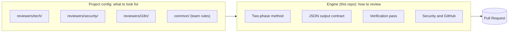
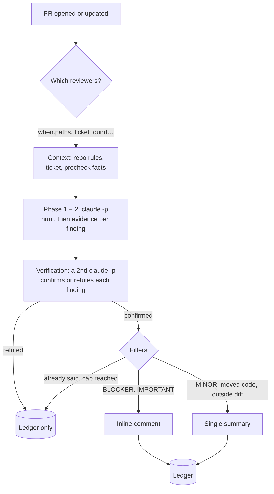
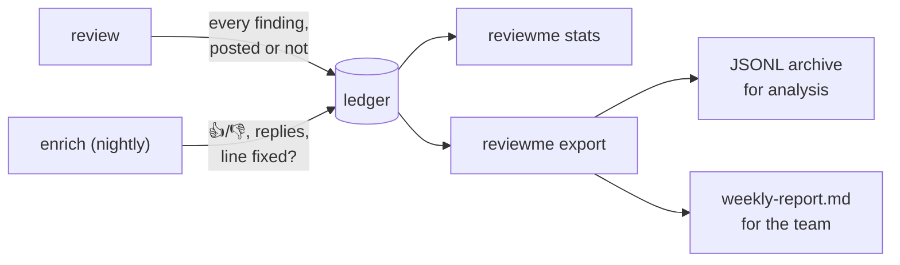

# ReviewMe

**English** · [Français](README.fr.md)

**An AI code review bot for GitHub Pull Requests.** It reads the diff and the repository,
then posts **line-by-line** comments, like a human reviewer. Several specialised
reviewers can run on the same PR: technical, security, translations, ticket criteria…

```text
src/orders/service.py, line 42
[IMPORTANT] `charge()` is called without `await`: the payment runs in the background and
any error is lost. Add `await` and let the exception propagate.
```

## Install

```sh
uv sync && npm install -g @anthropic-ai/claude-code
cp .env.example .env            # GITHUB_TOKEN, GITHUB_REPO, REPO_PATH
uv run reviewme review --repo my-org/my-app --pr 123 --dry-run
```

Requirements: Python 3.13, [uv](https://docs.astral.sh/uv/), the
[Claude Code](https://docs.anthropic.com/en/docs/claude-code) CLI on the `PATH`, and a
fine-grained GitHub token scoped to the reviewed repository. `--dry-run` prints what would
be posted without writing to GitHub; `REVIEWME_FAKE=1` skips the model entirely. The full
walkthrough is in [Start in 5 minutes](#start-in-5-minutes).

---

## The idea: method in the engine, knowledge in the config

ReviewMe keeps two things apart:

- **the engine (this repository)** knows *how* to review: the method, the output format,
  the verification pass, security, talking to GitHub. It is the same for every project;
- **a reviewer (a config folder)** knows *what* to look for in *this* project: its persona,
  its rules, when it runs. A team writes as many as it needs.



A project combines two kinds of reviewers, enabled in different ways:

| | Core reviewer | Custom reviewer |
|---|---|---|
| Defined | in the engine | in your repository, `reviewers/<name>/` |
| How to enable | its name in `core = [...]` in `project.toml` | its folder exists: nothing else to declare |
| How to disable | remove its name from the list | `enabled = false` in its `reviewer.toml` |
| Updates | follows the engine | yours |

Full example of a project using both:

```text
.reviewme/projects/shop/
├── project.toml              [reviewers] core = ["tech", "advisor"]
└── reviewers/
    └── security/             custom reviewer, active because the folder exists
        ├── reviewer.toml
        └── system.md
```

Three reviewers run on its PRs: `tech` and `advisor` (core), `security` (custom).

### Core reviewers: enable them by name

Shipped with the engine (`config/templates/reviewers/`), they follow its updates. Enable
them in the project's `project.toml`; removing a name disables it.

```toml
# .reviewme/projects/shop/project.toml
[reviewers]
core = ["tech", "advisor"]
```

| Name | Role | Output | Requires |
|---|---|---|---|
| `tech` | bugs, logic, security, repository conventions | inline | — |
| `us` | are the ticket's acceptance criteria covered? | one comment, silent when all are covered | Jira (`JIRA_BASE_URL`, `JIRA_EMAIL`, `JIRA_API_TOKEN`) |
| `i18n` | missing or doubtful translations | inline and summary | translation files in the PR (`*.strings`, `values*/strings.xml`…) |
| `advisor` | what a human must check themselves on this PR | one comment, silent when nothing applies | — |

**Adapt them without copying**: the project can tell a core reviewer where its docs
are, when to run and what it should know. Everything else (method, output, verification)
stays the engine's.

```toml
[reviewers.tech]
read = ["Documentation/ARCHITECTURE.md", "Documentation/"]   # added to what it reads
paths = ["src/**"]                                            # when it runs
instructions = "Business services live in src/services; no network calls from views."
# model = "…"   max_turns = 50   priority = 10   enabled = false
```

**Let an AI do it**: the [`skills/reviewme-create-reviewer`](skills/reviewme-create-reviewer/SKILL.md)
skill guides Claude Code to explore the repository, choose between adapting a
core reviewer and creating one, write a short persona and validate the config. Copy it into
the project's `.claude/skills/`, then ask for instance "add a reviewer that checks our
migrations".

### Custom reviewers: a folder in the project

For what is specific to **your** code, a reviewer is a folder under
`.reviewme/projects/<project>/reviewers/<name>/`, in the reviewed repository (or in a
separate config repository, via `REVIEWME_CONFIG_HOME`). The name is free; a folder named
after a core reviewer replaces it for that project.

```text
.reviewme/projects/shop/
├── project.toml                 project settings (optional)
├── common/
│   └── team-rules.md            team rules, shared by every reviewer
└── reviewers/
    └── security/
        ├── reviewer.toml        when it runs, what it reads
        └── system.md            its persona: what it looks for in THIS project
```

```toml
# reviewers/security/reviewer.toml
output_mode = "inline"                 # inline | global | mixed
priority    = 10

[when]                                 # only runs when these files change
paths = ["src/api/**", "src/auth/**"]

[context]                              # read from the reviewed repo, never copied here
read = ["docs/security.md"]

```

```markdown
<!-- reviewers/security/system.md -->
# Shop security reviewer
You look for: routes without access control, SQL built by string concatenation,
hard-coded secrets, customer data written to logs. `@public` decorators are intentional.
```

The engine adds the method, the output format and the repository's instruction files
(`CLAUDE.md`, `AGENTS.md`, `.claude/rules/`) on its own. The persona stays short.

---

## The life of a PR



- **Each reviewer is an independent, read-only `claude -p`** (`Read`, `Grep`, `Glob`,
  `git log/show/diff`), run in parallel.
- **Verification replaces the confidence threshold as the main filter.** A second call
  receives the findings and must cite the line that proves each one; anything unproven
  is not posted.
- **No duplicates across commits**: every comment carries a fingerprint of its line. When
  the line changes, the bot replies in the thread instead of posting again.

---

## Start in 5 minutes

```sh
git clone https://github.com/AccorECOM/reviewme.git && cd reviewme
uv sync
npm install -g @anthropic-ai/claude-code
cp .env.example .env            # GITHUB_TOKEN, GITHUB_REPO, REPO_PATH

uv run reviewme review --repo my-org/my-app --pr 123 --dry-run
```

`--dry-run` computes everything and prints what **would** be posted, without writing to
GitHub. Without `PROJECT`, a single generic reviewer runs (simple mode). For a real project, the
shortest path is a `project.toml` enabling core reviewers (see above):

```sh
mkdir -p .reviewme/projects/my-app
printf '[reviewers]\ncore = ["tech", "advisor"]\n' > .reviewme/projects/my-app/project.toml
REVIEWME_CONFIG_HOME=$PWD/.reviewme PROJECT=my-app uv run reviewme projects
```

To start from an editable copy of a core reviewer: `reviewme init-project my-app --reviewers tech`.

In CI: a GitHub Actions example lives in [`deploy/github-actions/`](deploy/github-actions/),
a Bitrise example in [`deploy/bitrise-step.md`](deploy/bitrise-step.md).

---

## Run it on your machine (watch mode)

No CI needed: `reviewme watch` checks a repository's open PRs every few minutes and
reviews each PR, again after every new push. It calls the Claude Code CLI exactly as it is set up on the
machine: ReviewMe does not choose how the CLI reaches the model. If `claude -p "hello"`
works in that terminal, watch works.

```sh
git clone git@github.com:my-org/my-app.git ~/src/my-app
uv run reviewme watch --repo my-org/my-app --repo-path ~/src/my-app --every 10m
```

Start with `--once --dry-run`: one round, nothing posted, the log shows which PRs would be
reviewed and why the others are left alone.

| Which PRs | Default | Change it with |
|---|---|---|
| open PRs | all of them | `--label review-me`: only PRs carrying this label |
| PRs labelled `no-ai-review` | left alone | `--skip-label NAME` (`""` disables it, or `REVIEWME_SKIP_LABEL`) |
| drafts | left alone | `--include-drafts` |
| PRs from forks | left alone | `--include-forks` (authors outside the repo) |
| a commit already reviewed | not reviewed again | a new push is reviewed |
| a commit whose review failed | not retried | a new push is retried |

How it behaves:

- **Your clone is never touched.** Each PR is checked out in a temporary `git worktree` at
  its head commit, next to the clone, and removed afterwards. Uncommitted work and the
  current branch stay as they are. `--repo-path` (or `REPO_PATH`) must be a clone of
  `--repo`: anything else is refused.
- **Same review as CI**: same reviewers, same config (still read from the base branch),
  same dedup, so running watch next to a CI job does not double the comments.
- **One PR at a time** by default (`--parallel N` to change it), every 10 minutes
  (`--every 90s|10m|1h`, or `POLL_INTERVAL`; minimum 1 minute).
- **Usage limits**: when the model's quota is reached, the commit is *not* marked
  as failed. The loop waits until the reset time the CLI gives (otherwise it doubles the
  wait, up to one hour), then resumes where it stopped.
- Comments are posted with the identity of `GITHUB_TOKEN`: your own account if it is
  your personal token, a bot if it is a GitHub App or a bot account's token.
- One watch per repository at a time (lock in `data/`). `--dashboard` serves the read-only
  dashboard on `127.0.0.1:8420`. Stop with Ctrl-C: the current review finishes first.

To keep it running, use a terminal multiplexer, or `--once` from `cron`/`launchd`.
`reviewme-poll` still works: it is the same loop configured from `.env` only
(`REVIEW_LABEL`, `REVIEW_ALL_PRS`, `POLL_INTERVAL`).

---

## What lands on the PR

| Finding | Where | Why |
|---|---|---|
| `BLOCKER`, `IMPORTANT` on code introduced by the PR | inline | worth the developer's attention |
| `MINOR` | summary | useful, but not worth a notification per line |
| on code the PR only **moved** | summary, tagged | not a defect of this PR |
| outside the diff lines | summary | GitHub rejects comments outside the diff |
| not confirmed by verification | nowhere (ledger) | a false positive costs the team's trust |
| **💡 Review tip** (`advisor` reviewer): something a human must check themselves (call order changed, file placed outside its usual folder…) | one comment | only when it applies, anchored in files of the PR; 3 at most |
| clean PR | nothing | silence beats a "LGTM" |

The language of the posted remarks and of the bot's headings is set per project in
`project.toml`: `[review] language = "fr"` (default `en`).

The bot only posts comments: never an approval or a change request.

---

## Measuring whether it helps



The ledger keeps **every** finding with its fate and confidence, including the dropped
ones, so you can answer "is this threshold costing us real bugs?". `reviewme stats` shows,
per reviewer, the share of findings acted upon, approved and contested, and calibration by
confidence band. The schema is in [`docs/ledger-schema.md`](docs/ledger-schema.md).
Finding text is only stored when the project asks for it
(`[ledger] include_text = true`).

---

## Security

The diff, the ticket and the comments are written by third parties: they are **data**,
never instructions.

- **Read-only tools**, allowlist locked in code: no `Write`, no sub-agents, never
  `--dangerously-skip-permissions`. Hooks and MCP servers of the reviewed repo are not
  loaded. A reviewer that declares its own MCP servers (`[mcp] config`) or plugins
  (`[plugins] install`) is also allowed their tools (`mcp__<server>`, `Skill`); the
  verification pass is not. A skill gets no more rights than the allowlist.
- **A PR cannot change its own review**: when the config lives in the reviewed repo
  (`.reviewme/`), it is read from the base branch, as are `CLAUDE.md` and `.claude/rules/`.
  To try a new reviewer inside its own PR, start a build by hand with
  `REVIEWME_CONFIG_SOURCE=pr`.
- Secrets and absolute paths are scrubbed before posting; the webhook rejects unsigned
  requests (HMAC).
- A `precheck` is code supplied by the project: review it like code.
- **On a personal machine** (watch mode), the agent runs with your user's file access:
  the tools are read-only, but a hostile diff could try to make it read files outside the
  repo. That is why PRs from forks are left alone by default; for a repo open to outside
  contributors, prefer `--label` or a dedicated user, container or VM.

---

## Quick reference

| Command | Purpose |
|---|---|
| `reviewme review --repo O/R --pr N` | review one PR (`--dry-run`, `--force`) |
| `reviewme init-project <name> --reviewers tech,us` | create a project from the skeleton |
| `reviewme projects` | list projects and their reviewers |
| `reviewme enrich --since 14d` | record what happened to posted findings (nightly) |
| `reviewme export --since 7d --out DIR` | analysis archive and readable report |
| `reviewme stats [--html F]` | counters and quality block |
| `reviewme feedback --pr N` | developer replies, as rules to review |
| `reviewme watch --repo O/R --every 10m` | poll the open PRs and review each one (`--once`, `--dry-run`, `--label`) |
| `reviewme-webhook` · `reviewme-poll` · `reviewme-web` | webhook server, poll loop (legacy name of watch), dashboard |

| Variable | Purpose |
|---|---|
| `GITHUB_TOKEN` (or `GITHUB_APP_ID` + key) | GitHub access |
| `REPO_PATH` | local clone of the reviewed repo |
| `REVIEWME_CONFIG_HOME`, `PROJECT` | where the config lives, which project |
| `CONFIDENCE_THRESHOLD` | confidence threshold (default 80) |
| `MAX_COMMENTS_PER_PR` | comment cap per PR (default 10) |
| `REVIEWME_INLINE_MIN_SEVERITY` | lowest severity posted inline (default `IMPORTANT`) |
| `REVIEWME_VERIFY` | `0` turns verification off |
| `REVIEWME_CONFIG_SOURCE` | `base` (default) or `pr` |
| `REVIEWME_FAKE`, `REVIEWME_DEBUG` | no model call; verbose log |
| `ANTHROPIC_BASE_URL`, `CLAUDE_MODEL` | LLM gateway, model |
| `POLL_INTERVAL`, `REVIEWME_SKIP_LABEL` | watch: default interval, opt-out label (default `no-ai-review`) |

| `project.toml` key | Purpose |
|---|---|
| `[review] language` | language of the posted remarks and of the bot's headings (default `en`, e.g. `"fr"`) |

Every key, commented: [`.env.example`](.env.example). Every `reviewer.toml`
option: [`docs/reviewme.html`](docs/reviewme.html). Known limits:
[`docs/LIMITATIONS.md`](docs/LIMITATIONS.md).

## Tests

```sh
uv sync --group dev
uv run pytest -q
uv run ruff check .
```

## Contributing and security

Guidelines in [`CONTRIBUTING.md`](CONTRIBUTING.md). Threat model and how to report a
vulnerability in [`SECURITY.md`](SECURITY.md).

## License

Apache 2.0 — free to use, modify and share. See [`LICENSE`](LICENSE).
