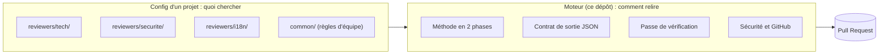
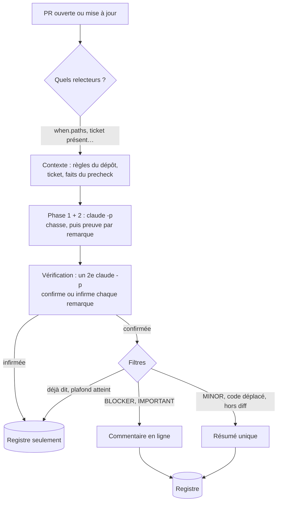
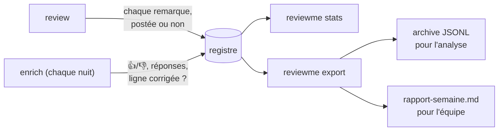

# ReviewMe

🇫🇷 Français · [🇬🇧 English](README.en.md)

**Un bot de code review par IA pour les Pull Requests GitHub.** Il lit le diff et le
dépôt, puis poste des commentaires **ligne par ligne**, comme un relecteur humain.
Plusieurs relecteurs spécialisés peuvent tourner sur la même PR : technique, sécurité,
traductions, critères du ticket…

```text
src/orders/service.py, ligne 42
[IMPORTANT] `charge()` est appelée sans `await` : le paiement part en tâche de fond et
l'erreur éventuelle est perdue. Ajouter `await` et laisser l'exception remonter.
```

---

## Le principe : la méthode dans le moteur, la connaissance dans la config

ReviewMe sépare deux choses :

- **le moteur (ce dépôt)** sait *comment* relire : la méthode, le format de sortie, la
  vérification, la sécurité, le dialogue avec GitHub. Il est le même pour tous les projets ;
- **un relecteur (un dossier de config)** sait *quoi* chercher dans *ce* projet : sa
  persona, ses règles, quand il se déclenche. Une équipe en écrit autant qu'elle veut.



Un relecteur, c'est **un dossier** et deux fichiers :

```text
.reviewme/projects/boutique/
├── project.toml                 réglages du projet (optionnel)
├── common/
│   └── regles-terrain.md        règles de l'équipe, communes à tous les relecteurs
└── reviewers/
    └── securite/
        ├── reviewer.toml        quand il tourne, ce qu'il lit
        └── system.md            sa persona : ce qu'il cherche dans CE projet
```

```toml
# reviewers/securite/reviewer.toml
output_mode = "inline"                 # inline | global | mixed
priority    = 10

[when]                                 # ne tourne que si ces fichiers changent
paths = ["src/api/**", "src/auth/**"]

[context]                              # lus dans le dépôt relu, jamais recopiés ici
read = ["docs/securite.md"]
```

```markdown
<!-- reviewers/securite/system.md -->
# Relecteur sécurité de la boutique
Tu cherches : routes sans contrôle d'accès, SQL construit par concaténation, secrets en
dur, données client écrites dans les logs. Les décorateurs `@public` sont volontaires.
```

Le moteur ajoute tout seul la méthode, le format de sortie et les fichiers d'instructions
du dépôt (`CLAUDE.md`, `AGENTS.md`, `.claude/rules/`). La persona reste courte.

---

## Le parcours d'une PR



- **Chaque relecteur est un `claude -p` indépendant**, en lecture seule (`Read`, `Grep`,
  `Glob`, `git log/show/diff`), lancé en parallèle.
- **La vérification remplace le seuil de confiance comme filtre principal.** Un second
  appel reçoit les remarques et doit citer la ligne qui prouve chacune ; ce qui n'est pas
  prouvé n'est pas posté.
- **Pas de doublon d'un commit à l'autre** : chaque commentaire porte une empreinte de sa
  ligne. Si la ligne change, le bot répond dans le fil au lieu de reposter.

---

## Démarrer en 5 minutes

```sh
git clone https://github.com/AccorECOM/reviewme.git && cd reviewme
uv sync
npm install -g @anthropic-ai/claude-code
cp .env.example .env            # GITHUB_TOKEN, GITHUB_REPO, REPO_PATH

uv run reviewme review --repo mon-org/mon-app --pr 123 --dry-run
```

`--dry-run` calcule tout et affiche ce qui **serait** posté, sans rien écrire sur GitHub.
Sans `PROJECT`, un seul relecteur générique tourne (mode simple). Pour créer ses
relecteurs :

```sh
REVIEWME_CONFIG_HOME=$PWD/.reviewme uv run reviewme init-project mon-app --reviewers tech,i18n
```

En CI : un exemple GitHub Actions est dans [`deploy/github-actions/`](deploy/github-actions/),
un exemple Bitrise dans [`deploy/bitrise-step.md`](deploy/bitrise-step.md).

---

## Ce qui arrive sur la PR

| Remarque | Où | Pourquoi |
|---|---|---|
| `BLOCKER`, `IMPORTANT` sur du code introduit par la PR | en ligne | c'est ce qui mérite l'attention du dev |
| `MINOR` | résumé | utile, mais pas au prix d'une notification par ligne |
| sur du code seulement **déplacé** par la PR | résumé, tagué | ce n'est pas un défaut de la PR |
| hors des lignes du diff | résumé | GitHub refuse un commentaire hors diff |
| non confirmée par la vérification | nulle part (registre) | un faux positif coûte la confiance de l'équipe |
| PR propre | rien | le silence vaut mieux qu'un « RAS » |

Le bot ne poste que des commentaires : jamais d'approbation ni de demande de changement.

---

## Mesurer si c'est utile



Le registre garde **toutes** les remarques avec leur sort et leur confiance, y compris
celles écartées. On peut donc répondre à « ce seuil nous coûte-t-il des vrais bugs ? ».
`reviewme stats` affiche, par relecteur, la part de remarques suivies d'effet, approuvées
et contestées, et la calibration par tranche de confiance. Le schéma est décrit dans
[`docs/registre-schema.md`](docs/registre-schema.md). Le texte des remarques n'y est écrit
que si le projet le demande (`[ledger] include_text = true`).

---

## Sécurité

Le diff, le ticket et les commentaires sont écrits par des tiers : ce sont des
**données**, jamais des instructions.

- **Outils en lecture seule**, liste verrouillée dans le code : ni `Write`, ni sous-agents,
  ni `--dangerously-skip-permissions`. Ni les hooks ni les serveurs MCP du dépôt relu ne
  sont chargés.
- **Une PR ne change pas sa propre relecture** : si la config vit dans le dépôt relu
  (`.reviewme/`), elle est lue sur la branche de base, tout comme `CLAUDE.md` et
  `.claude/rules/`. Pour tester un nouveau relecteur dans sa PR, on lance un build à la
  main avec `REVIEWME_CONFIG_SOURCE=pr`.
- Secrets et chemins absolus masqués avant tout post ; webhook refusé sans signature HMAC.
- Un `precheck` est du code fourni par le projet : il se relit comme du code.

---

## Référence rapide

| Commande | Rôle |
|---|---|
| `reviewme review --repo O/R --pr N` | relire une PR (`--dry-run`, `--force`) |
| `reviewme init-project <nom> --reviewers tech,us` | créer un projet depuis le squelette |
| `reviewme projects` | lister les projets et leurs relecteurs |
| `reviewme enrich --since 14d` | relever le devenir des remarques (job de nuit) |
| `reviewme export --since 7d --out DIR` | archive d'analyse et rapport lisible |
| `reviewme stats [--html F]` | compteurs et bloc qualité |
| `reviewme feedback --pr N` | réponses des devs, en règles à relire |
| `reviewme-webhook` · `reviewme-poll` · `reviewme-web` | serveur webhook, boucle de poll, tableau de bord |

| Variable | Rôle |
|---|---|
| `GITHUB_TOKEN` (ou `GITHUB_APP_ID` + clé) | accès GitHub |
| `REPO_PATH` | clone local du dépôt relu |
| `REVIEWME_CONFIG_HOME`, `PROJECT` | où est la config, et quel projet |
| `CONFIDENCE_THRESHOLD` | seuil de confiance (défaut 80) |
| `MAX_COMMENTS_PER_PR` | plafond de commentaires par PR (défaut 10) |
| `REVIEWME_INLINE_MIN_SEVERITY` | sévérité minimale en ligne (défaut `IMPORTANT`) |
| `REVIEWME_VERIFY` | `0` coupe la vérification |
| `REVIEWME_CONFIG_SOURCE` | `base` (défaut) ou `pr` |
| `REVIEWME_FAKE`, `REVIEWME_DEBUG` | sans appel au modèle ; journal détaillé |
| `ANTHROPIC_BASE_URL`, `CLAUDE_MODEL` | passerelle LLM, modèle |

Toutes les clés, commentées : [`.env.example`](.env.example). Toutes les options de
`reviewer.toml` : [`docs/reviewme.html`](docs/reviewme.html). Limites connues :
[`ROADMAP.md`](ROADMAP.md).

## Tests

```sh
uv run --with pytest pytest tests/
uvx ruff check .
```
