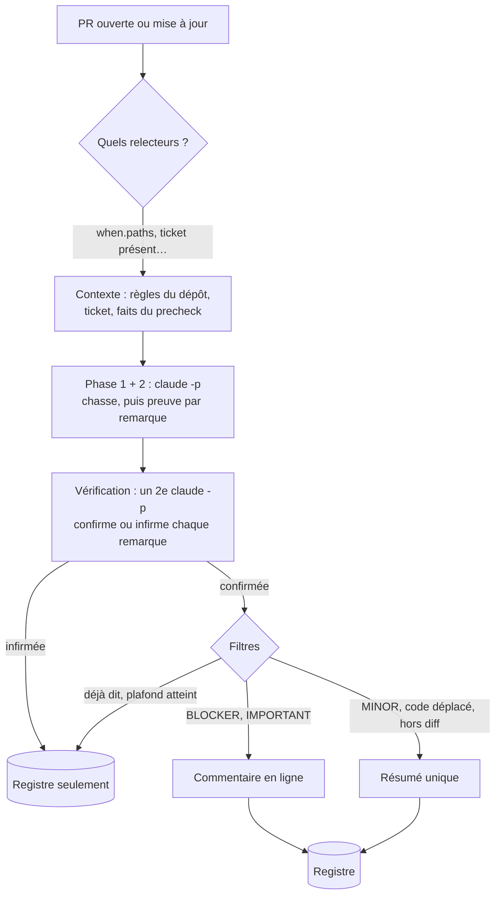

[← ReviewMe](../../README.fr.md) · [English](../how-it-works.md) · **Français**

# Comment se déroule une review

## Le parcours d'une PR

- **Chaque relecteur est un `claude -p` indépendant**, en lecture seule (`Read`, `Grep`,
  `Glob`, `git log/show/diff`), lancé en parallèle.
- **La vérification remplace le seuil de confiance comme filtre principal.** Un second
  appel reçoit les remarques et doit citer la ligne qui prouve chacune ; ce qui n'est pas
  prouvé n'est pas posté.
- **Pas de doublon d'un commit à l'autre** : chaque commentaire porte une empreinte de sa
  ligne. Si la ligne change, le bot répond dans le fil au lieu de reposter.

## D'où vient la config (branche base)

Une PR ne doit pas pouvoir changer la façon dont elle est relue. Quand la config du projet
vit dans le dépôt relu (`.reviewme/`), le moteur ne la lit donc **pas** dans le checkout
de la PR : il l'extrait de `origin/<base>`, la branche visée par la PR. `CLAUDE.md`,
`AGENTS.md` et `.claude/rules/` sont lus au même endroit. Un changement de config ne
s'applique qu'une fois mergé.

Trois étapes, avant tout appel au modèle :

1. **Fetch de la branche base.** `git fetch origin <base> --depth 50`, best-effort, borné
   par `FETCH_BASE_TIMEOUT` (secondes, défaut `30`). Un timeout ou une erreur est seulement
   logué (`fetch of '<base>' abandoned`) ; le run continue.
2. **Vérifier que la base est de confiance.** Quiconque peut pousser une branche peut
   ouvrir une PR vers elle, après y avoir préparé la config (et le precheck, qui tourne en
   CI) qui va la relire. Seules la branche par défaut du dépôt et les motifs de
   `REVIEWME_TRUSTED_BASES` sont acceptés (séparés par des virgules, jokers `*` :
   `develop,release/*`). Défaut : vide, donc la branche par défaut seule.
3. **Lire la config** avec `git archive origin/<base>`. Pas de repli sur la config de la PR.

### Quand une PR n'est pas relue

Si l'étape 2 ou 3 échoue, la PR n'est **pas relue** : rien n'est posté, le log dit
pourquoi et `reviewme review` sort en code 1 (le step CI échoue).

| Situation | Log | Solution |
|---|---|---|
| PR vers une branche qui n'est pas de confiance (ex. `feature/a` → `feature/b`) | `base branch 'feature/b' is not a trusted config source` | ajouter le motif à `REVIEWME_TRUSTED_BASES` (ex. `develop,feature/*`), en sachant que quiconque peut pousser une telle branche peut alors en façonner la config |
| `origin/<base>` absent : fetch expiré ou en échec sur un clone CI single-branch, ou `FETCH_BASE_TIMEOUT=0` | `` `.reviewme` not found on origin/<base> `` | monter `FETCH_BASE_TIMEOUT` (ex. `120`), ou faire fetcher la branche base par le clone CI |
| `.reviewme/` pas encore mergé sur la base (première mise en place) | idem | merger la config d'abord, ou la tester avec `REVIEWME_CONFIG_SOURCE=pr` (ci-dessous) |

Ne jamais mettre `FETCH_BASE_TIMEOUT=0` en CI avec une config dans le dépôt : sauf si le
clone a déjà `origin/<base>`, plus aucune PR n'est relue.

### Réglages

| Variable | Défaut | Rôle |
|---|---|---|
| `FETCH_BASE_TIMEOUT` | `30` | timeout du fetch de la branche base, en secondes ; `0` saute le fetch |
| `REVIEWME_TRUSTED_BASES` | vide | branches base de confiance en plus de la branche par défaut |
| `REVIEWME_CONFIG_SOURCE` | `base` | `pr` lit la config dans la PR elle-même : pour essayer un nouveau relecteur dans sa propre PR, via un build lancé à la main, jamais en réglage permanent (`REVIEWME_CONFIG_FROM_BASE=0` en est un ancien synonyme) |

Ce sont des **réglages du job** : à mettre dans l'environnement CI (variables Bitrise,
`env:` GitHub Actions) ou dans le `.env` du moteur. Le `.env` d'une instance ne peut pas
les régler (il peut arriver par une PR), et `project.toml` n'a pas de clé pour eux.

Une config gardée **hors** du dépôt relu (un dépôt de config séparé via
`REVIEWME_CONFIG_HOME`) n'est pas lue depuis la PR : les étapes 2 et 3 ne s'appliquent pas.
