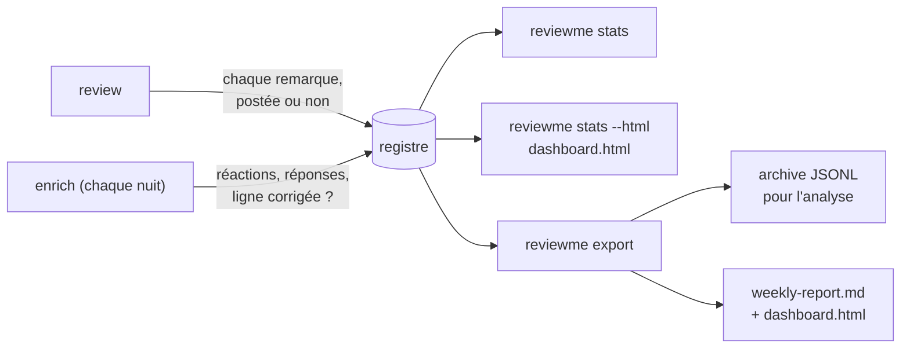

[← ReviewMe](../../README.fr.md) · [English](../measuring.md) · **Français**

# Mesurer si c'est utile



## Le registre

Le registre garde **toutes** les remarques avec leur sort et leur confiance, y compris
celles écartées. On peut donc répondre à « ce seuil nous coûte-t-il des vrais bugs ? ».
`reviewme stats` affiche, par relecteur, la part de remarques suivies d'effet, approuvées
et contestées, et la calibration par tranche de confiance. Le schéma est décrit dans
[`docs/ledger-schema.md`](../ledger-schema.md) (en anglais). Le texte des remarques n'y est écrit
que si le projet le demande (`[ledger] include_text = true`).

## Le tableau de bord

`reviewme stats --html dashboard.html` écrit un tableau de bord autonome à partir du
registre : une page par section (synthèse, qualité, usage, coût, ROI, fiabilité,
réglages, historique, Hall of Fame), sans requête réseau, lisible sur téléphone. `reviewme export` écrit la même
page à côté de `weekly-report.md`, et `reviewme-web` la sert à jour sur `/dashboard` (ses
chiffres sur `/api/dashboard`). Elle ne montre que des compteurs, des identifiants de
relecteurs et de règles, des numéros de PR et des logins (ou des noms masqués) : jamais un
titre de PR, une remarque, un extrait de code ni une réponse, même avec `include_text`
(seule exception : les manqués récurrents de `reviewme triage`, plus bas).
Chaque graphique et chaque tableau a une ligne de lecture en dessous (tendance,
comparaison, élément en tête), générée à partir de ses chiffres.
Elle fonctionne sans projet ; avec un projet, `[stats]` dans `project.toml` la règle :

```toml
[stats]
sections = ["summary", "quality", "usage", "cost", "roi", "reliability", "tuning",
            "history", "hall_of_fame"]
names = "login"             # ou "masked" : dev_1, dev_2… à la place des logins
window = "90d"              # 14d, 36h…
period = "week"             # ou "sprint"
sprint_anchor = "2026-01-05"
sprint_anchor_number = 1
sprint_length_days = 14
control_group = true        # enrich note aussi les PR que le bot n'a jamais relues
debrief = true              # la synthèse s'ouvre sur quelques phrases générées
bot_since = "2026-10-01"    # facultatif : le jour où le bot a démarré (défaut : 1er passage live)

[stats.triage]              # facultatif : `reviewme triage` (tri des retours par un LLM)
enabled = true              # défaut true
model = "claude-sonnet-5-5" # défaut : CLAUDE_MODEL, sinon le défaut de la CLI
max_budget_usd = 0.50       # budget d'un passage, défaut 0.50

[stats.judgment]            # réactions GitHub -> jugement d'une remarque
useful = ["+1", "hooray"]
wrong = ["-1"]
off_topic = ["confused"]
saved_me = ["rocket"]

[stats.roi]                 # facultatif : les hypothèses de l'estimation du ROI
hourly_cost = 80            # coût d'une heure de développeur, en `currency` (obligatoire)
currency = "EUR"            # défaut EUR
usd_rate = 0.92             # 1 USD en `currency` (le coût API est en USD) ; défaut 1.0
minutes_per_finding = 12    # gagnées par remarque suivie d'effet ; défaut 12
minutes_per_blocker = 240   # gagnées par BLOCKER corrigé avant merge ; défaut 240
human_first_review_hours = 20   # utilisé quand le groupe témoin ne le mesure pas
```

| Clé `[stats]` | Défaut | Rôle |
|---|---|---|
| `sections` | toutes | pages et ordre du menu : `summary`, `quality`, `usage`, `cost`, `roi`, `reliability`, `tuning`, `history`, `hall_of_fame` |
| `names` | `"login"` | `"masked"` numérote les personnes `dev_1`, `dev_2`… par ordre d'apparition |
| `window` | `"90d"` | période couverte (`export` utilise son propre `--since`) |
| `period` | `"week"` | regroupement des graphiques : semaine ISO (`week`) ou `sprint` |
| `sprint_anchor`, `sprint_anchor_number`, `sprint_length_days` | `2026-01-05`, `1`, `14` | premier jour et numéro d'un sprint connu, et durée d'un sprint |
| `[stats.judgment]` | comme ci-dessus | réactions comptées comme `useful`, `wrong`, `off_topic`, `saved_me` |
| `[stats.roi]` | absent | hypothèses de l'estimation du ROI (ci-dessus). Absent : la page ROI montre ses deux niveaux mesurés et dit pourquoi l'estimation est masquée ; présent : l'estimation, et une tuile « heures gagnées (estimation) » dans la synthèse. `hourly_cost` est obligatoire, chaque nombre doit être > 0 |
| `bot_since` | premier passage live | `AAAA-MM-JJ` du démarrage du bot, pour l'avant/après des pages historique et ROI, quand le registre ne remonte pas jusque-là |
| `[[stats.eras]]` | aucune | périodes nommées des pages historique et ROI (ci-dessous) ; présentes, elles remplacent `bot_since` |
| `[stats.triage]` | activé, modèle de la CLI, 0.50 $ | `reviewme triage` : `enabled = false` coupe la commande, `model` choisit le modèle de ce seul appel, `max_budget_usd` plafonne un passage (`--max-budget-usd` le remplace) |
| `debrief` | `true` | la synthèse s'ouvre sur une carte « En bref » : jusqu'à sept phrases courtes générées à partir des chiffres (sans LLM), chacune seulement quand ses données existent : volume et couverture, qualité, coût, ROI (groupe témoin, sinon l'estimation), historique (avant contre la dernière ère, sans lien de cause), incidents, règle la plus contestée. `false` la masque |
| `control_group` | `true` | `reviewme enrich` écrit aussi une ligne `prs.jsonl` (`reviewed = false`) pour chaque PR mise à jour sur la fenêtre que le bot n'a jamais relue : deux appels GitHub en lecture par PR. Le tableau de bord en tire la couverture (PR mergées relues) et le groupe de comparaison des temps de cycle. `REVIEWME_CONTROL_GROUP=0` le coupe pour un passage |

Une section ou une clé inconnue fait échouer le chargement, comme le reste de `project.toml`. Pour
le tableau de bord, un projet invalide n'est jamais silencieux : `reviewme stats --html`
(et `export`, `reviewme-web`) affiche un avertissement qui nomme l'erreur. Quand seuls les
relecteurs sont en cause (un dossier qui porte le `[stats]` d'un dépôt mais pas encore de
relecteur), la page suit quand même le `[stats]` de ce dossier ; quand `project.toml`
lui-même est invalide, elle prend les valeurs par défaut.

## ROI

La page **ROI** répond à « est-ce que ça vaut le coup ? » de trois façons, de la plus à la
moins solide, chacune étiquetée comme telle : (1) *mesuré* sur le groupe témoin, PR relues
contre non relues de la même fenêtre (délai avant la première relecture humaine, avant
le merge, relectures et commentaires humains par PR, rapidité du bot) ; (2) *mesuré dans
le temps*, l'avant/après de la page historique ; (3) *estimé* à partir de `[stats.roi]` :
remarques suivies d'effet et BLOCKER corrigés avant merge, valorisés en temps et en argent
face au coût API, avec le point mort (remarques suivies d'effet par PR nécessaires pour
couvrir le coût par PR), chaque hypothèse affichée à côté des chiffres.
