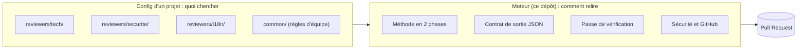

[← ReviewMe](../../README.fr.md) · [English](../reviewers.md) · **Français**

# Relecteurs

## La méthode dans le moteur, la connaissance dans la config

ReviewMe sépare deux choses :

- **le moteur (ce dépôt)** sait *comment* relire : la méthode, le format de sortie, la
  vérification, la sécurité, le dialogue avec GitHub. Il est le même pour tous les projets ;
- **un relecteur (un dossier de config)** sait *quoi* chercher dans *ce* projet : sa
  persona, ses règles, quand il se déclenche. Une équipe en écrit autant qu'elle veut.



Un projet combine deux sortes de relecteurs, qui s'activent différemment :

| | Relecteur du core | Relecteur custom |
|---|---|---|
| Où il est défini | dans le moteur | dans votre dépôt, `reviewers/<nom>/` |
| Comment l'activer | son nom dans `core = [...]` du `project.toml` | son dossier existe : rien d'autre à déclarer |
| Comment le couper | retirer son nom de la liste | `enabled = false` dans son `reviewer.toml` |
| Mises à jour | suit le moteur | les vôtres |

Exemple complet d'un projet qui utilise les deux :

```text
.reviewme/projects/boutique/
├── project.toml              [reviewers] core = ["tech", "advisor"]
└── reviewers/
    └── securite/             relecteur custom, actif parce que le dossier existe
        ├── reviewer.toml
        └── system.md
```

Trois relecteurs tournent sur ses PR : `tech` et `advisor` (core), `securite` (custom).

## Relecteurs du core : à activer par leur nom

Fournis par le moteur (`config/templates/reviewers/`), ils suivent ses mises à jour. On les
active dans le `project.toml` du projet ; retirer un nom les désactive.

```toml
# .reviewme/projects/boutique/project.toml
[reviewers]
core = ["tech", "advisor"]
```

| Nom | Rôle | Sortie | Prérequis |
|---|---|---|---|
| `tech` | bugs, logique, sécurité, conventions du dépôt | en ligne | — |
| `us` | les critères d'acceptation du ticket sont-ils couverts ? | un commentaire, muet si tout est couvert | Jira (`JIRA_BASE_URL`, `JIRA_EMAIL`, `JIRA_API_TOKEN`) |
| `i18n` | traductions manquantes ou douteuses | en ligne et résumé | fichiers de traduction dans la PR (`*.strings`, `values*/strings.xml`…) |
| `advisor` | ce qu'un humain doit valider lui-même sur cette PR | un commentaire, muet si rien d'applicable | — |

**Les adapter sans les copier** : le projet peut indiquer à un relecteur du core où est
sa doc, quand tourner et ce qu'il doit savoir. Le reste (méthode, sortie, vérification)
reste celui du moteur.

```toml
[reviewers.tech]
read = ["Documentation/ARCHITECTURE.md", "Documentation/"]   # ajouté à sa lecture
paths = ["src/**"]                                            # quand il tourne
instructions = "Les services métier sont dans src/services ; pas d'appel réseau dans les vues."
# model = "…"   max_turns = 50   priority = 10   enabled = false
```

**Laisser une IA le faire** : le skill [`skills/reviewme-create-reviewer`](../../skills/reviewme-create-reviewer/SKILL.md)
guide Claude Code pour explorer le dépôt, choisir entre adapter un relecteur du core et en
créer un, écrire une persona courte et valider la config. Copiez-le dans `.claude/skills/`
du projet, puis demandez par exemple « ajoute un relecteur qui vérifie nos migrations ».

## Relecteurs custom : un dossier dans le projet

Pour ce qui est propre à **votre** code, un relecteur est un dossier sous
`.reviewme/projects/<projet>/reviewers/<nom>/`, dans le dépôt relu (ou dans un dépôt de
config à part, via `REVIEWME_CONFIG_HOME`). Son nom est libre ; un dossier qui porte le nom
d'un relecteur du core le remplace pour ce projet.

```text
.reviewme/projects/boutique/
├── project.toml                 réglages du projet (optionnel)
├── common/
│   └── team-rules.md            règles de l'équipe, communes à tous les relecteurs
└── reviewers/
    └── securite/
        ├── reviewer.toml        quand il tourne, ce qu'il lit
        └── system.md            sa persona : ce qu'il cherche dans CE projet
```

```toml
# reviewers/securite/reviewer.toml
output_mode = "inline"                 # inline | global | mixed
priority    = 10

[when]                                 # ne tourne que si ces fichiers changent
paths = ["src/api/**", "src/auth/**"]

[context]                              # lus dans le dépôt relu, jamais recopiés ici
read = ["docs/securite.md"]

```

```markdown
<!-- reviewers/securite/system.md -->
# Relecteur sécurité de la boutique
Tu cherches : routes sans contrôle d'accès, SQL construit par concaténation, secrets en
dur, données client écrites dans les logs. Les décorateurs `@public` sont volontaires.
```

Le moteur ajoute tout seul la méthode, le format de sortie et les fichiers d'instructions
du dépôt (`CLAUDE.md`, `AGENTS.md`, `.claude/rules/`). La persona reste courte.
