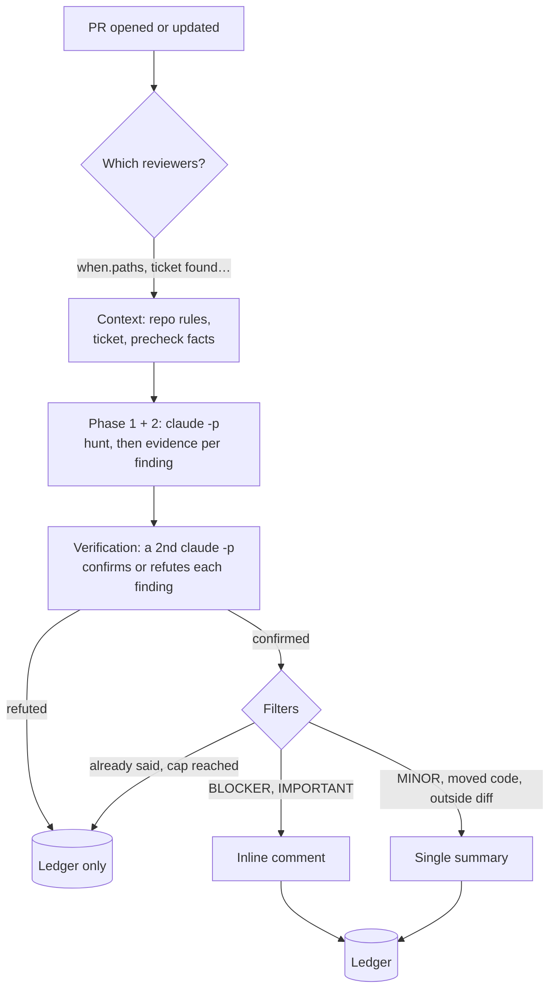

[← ReviewMe](../README.md) · **English** · [Français](fr/how-it-works.md)

# How a review runs

## The life of a PR

- **Each reviewer is an independent, read-only `claude -p`** (`Read`, `Grep`, `Glob`,
  `git log/show/diff`), run in parallel.
- **Verification replaces the confidence threshold as the main filter.** A second call
  receives the findings and must cite the line that proves each one; anything unproven
  is not posted.
- **No duplicates across commits**: every comment carries a fingerprint of its line. When
  the line changes, the bot replies in the thread instead of posting again.

## Where the config is read from (base branch)

A PR must not be able to change how it is reviewed. So when the project config lives in
the reviewed repository (`.reviewme/`), the engine does **not** read it from the PR's
checkout: it extracts it from `origin/<base>`, the branch the PR targets. `CLAUDE.md`,
`AGENTS.md` and `.claude/rules/` are read from there too. A config change only applies
once it is merged.

Three steps, before any model call:

1. **Fetch the base branch.** `git fetch origin <base> --depth 50`, best-effort, bounded
   by `FETCH_BASE_TIMEOUT` (seconds, default `30`). A timeout or an error is only logged
   (`fetch of '<base>' abandoned`); the run goes on.
2. **Check that the base is trusted.** Anyone who can push a branch can open a PR towards
   it, after preparing there the config (and the precheck, which runs in CI) that will
   review it. Only the repository's default branch and the patterns of
   `REVIEWME_TRUSTED_BASES` are accepted (comma-separated, `*` wildcards:
   `develop,release/*`). Default: empty, so the default branch only.
3. **Read the config** with `git archive origin/<base>`. There is no fallback to the PR's
   config.

### When a PR is not reviewed

If step 2 or 3 fails, the PR is **not reviewed**: nothing is posted, the log says why and
`reviewme review` exits with code 1 (the CI step fails).

| Situation | Log | Fix |
|---|---|---|
| PR towards a branch that is not trusted (e.g. `feature/a` → `feature/b`) | `base branch 'feature/b' is not a trusted config source` | add the pattern to `REVIEWME_TRUSTED_BASES` (e.g. `develop,feature/*`), knowing that whoever can push such a branch can then shape its config |
| `origin/<base>` missing: the fetch timed out or failed on a single-branch CI clone, or `FETCH_BASE_TIMEOUT=0` | `` `.reviewme` not found on origin/<base> `` | raise `FETCH_BASE_TIMEOUT` (e.g. `120`), or have the CI clone fetch the base branch |
| `.reviewme/` not merged on the base yet (first setup) | same | merge the config first, or test it with `REVIEWME_CONFIG_SOURCE=pr` (below) |

Never set `FETCH_BASE_TIMEOUT=0` in CI with an in-repo config: unless the clone already has
`origin/<base>`, no PR gets reviewed.

### Settings

| Variable | Default | Purpose |
|---|---|---|
| `FETCH_BASE_TIMEOUT` | `30` | timeout of the base branch fetch, in seconds; `0` skips the fetch |
| `REVIEWME_TRUSTED_BASES` | empty | extra trusted base branches, besides the default branch |
| `REVIEWME_CONFIG_SOURCE` | `base` | `pr` reads the config from the PR itself: to try a new reviewer in its own PR with a build started by hand, never as a permanent setting (`REVIEWME_CONFIG_FROM_BASE=0` is a legacy synonym) |

These are **job settings**: set them in the CI environment (Bitrise env vars, GitHub
Actions `env:`) or in the engine's own `.env`. An instance's `.env` cannot set them (it can
arrive through a PR), and `project.toml` has no key for them.

A config kept **outside** the reviewed repository (a separate config repository via
`REVIEWME_CONFIG_HOME`) is not read from the PR, so steps 2 and 3 do not apply to it.
