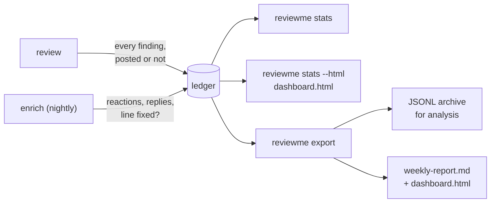

[← ReviewMe](../README.md) · **English** · [Français](fr/measuring.md)

# Measuring whether it helps



## The ledger

The ledger keeps **every** finding with its fate and confidence, including the dropped
ones, so you can answer "is this threshold costing us real bugs?". `reviewme stats` shows,
per reviewer, the share of findings acted upon, approved and contested, and calibration by
confidence band. The schema is in [`docs/ledger-schema.md`](ledger-schema.md).
Finding text is only stored when the project asks for it
(`[ledger] include_text = true`).

## The dashboard

`reviewme stats --html dashboard.html` writes a standalone dashboard from the ledger: one
page per section (summary, quality, usage, cost, ROI, reliability, tuning, history, Hall
of Fame), no
network request, readable on a phone. `reviewme export` writes the same page next to
`weekly-report.md`, and `reviewme-web` serves it fresh on `/dashboard` (its numbers on
`/api/dashboard`). It only shows counters, reviewer and rule ids, PR numbers and logins
(or masked names): never a PR title, a finding, a code excerpt or a reply, even with
`include_text` (the one exception: the recurring misses of `reviewme triage`, below).
Every chart and table has a one-line reading under it (trend, comparison, top item),
generated from its numbers. It works without a project; with one, `[stats]` in `project.toml` shapes it:

```toml
[stats]
sections = ["summary", "quality", "usage", "cost", "roi", "reliability", "tuning",
            "history", "hall_of_fame"]
names = "login"             # or "masked": dev_1, dev_2… instead of logins
window = "90d"              # 14d, 36h…
period = "week"             # or "sprint"
sprint_anchor = "2026-01-05"
sprint_anchor_number = 1
sprint_length_days = 14
control_group = true        # enrich also records the PRs the bot never reviewed
debrief = true              # the summary opens with a few generated sentences
bot_since = "2026-10-01"    # optional: the day the bot started (default: first live run)

[stats.triage]              # optional: `reviewme triage` (LLM sort of the feedback)
enabled = true              # default true
model = "claude-sonnet-5-5" # default: CLAUDE_MODEL, else the CLI default
max_budget_usd = 0.50       # budget of one pass, default 0.50

[stats.judgment]            # GitHub reactions -> judgment of a finding
useful = ["+1", "hooray"]
wrong = ["-1"]
off_topic = ["confused"]
saved_me = ["rocket"]

[stats.roi]                 # optional: the assumptions of the ROI estimate
hourly_cost = 80            # cost of one developer hour, in `currency` (required)
currency = "EUR"            # default EUR
usd_rate = 0.92             # 1 USD in `currency` (the API cost is in USD); default 1.0
minutes_per_finding = 12    # saved per finding acted upon; default 12
minutes_per_blocker = 240   # saved per BLOCKER fixed before merge; default 240
human_first_review_hours = 20   # used when the control group does not measure it
```

| `[stats]` key | Default | Purpose |
|---|---|---|
| `sections` | all of them | pages and menu order: `summary`, `quality`, `usage`, `cost`, `roi`, `reliability`, `tuning`, `history`, `hall_of_fame` |
| `names` | `"login"` | `"masked"` numbers people `dev_1`, `dev_2`… by first appearance |
| `window` | `"90d"` | period covered (`export` uses its own `--since`) |
| `period` | `"week"` | chart buckets: ISO `week` or `sprint` |
| `sprint_anchor`, `sprint_anchor_number`, `sprint_length_days` | `2026-01-05`, `1`, `14` | first day and number of a known sprint, and sprint length |
| `[stats.judgment]` | as above | reaction contents counted as `useful`, `wrong`, `off_topic`, `saved_me` |
| `[stats.roi]` | absent | assumptions of the ROI estimate (above). Absent: the ROI page shows its two measured levels and says why the estimate is hidden; present: the estimate, and an "hours saved (estimated)" tile in the summary. `hourly_cost` is required, every number must be > 0 |
| `bot_since` | first live run | `YYYY-MM-DD` the bot started, for the before/after of the history and ROI pages, when the ledger does not go back that far |
| `[[stats.eras]]` | none | named periods of the history and ROI pages (below); when present, they replace `bot_since` |
| `[stats.triage]` | enabled, CLI model, 0.50 $ | `reviewme triage`: `enabled = false` turns the command off, `model` picks the model of that call only, `max_budget_usd` caps one pass (`--max-budget-usd` overrides it) |
| `debrief` | `true` | the summary opens with a "Debrief" card: up to seven short sentences generated from the numbers (no LLM), each only when its data exists: volume and coverage, quality, cost, ROI (control group, else the estimate), history (before vs the last era, not causal), incidents, the most contested rule. `false` hides it |
| `control_group` | `true` | `reviewme enrich` also writes a `prs.jsonl` line (`reviewed = false`) for every PR updated in the window that the bot never reviewed: two read-only GitHub calls per such PR. It gives the dashboard its coverage (merged PRs reviewed) and the comparison group for cycle times. `REVIEWME_CONTROL_GROUP=0` turns it off for one run |

An unknown section or key fails at load time, like the rest of `project.toml`. For
the dashboard, an invalid project is never silent: `reviewme stats --html` (and `export`,
`reviewme-web`) prints a warning naming the error. When only the reviewers are at fault
(a folder that holds the `[stats]` of a repository but no reviewer yet), the page still
follows that folder's `[stats]`; when `project.toml` itself is invalid, it uses the
defaults.

## ROI

The **ROI** page answers "is it worth it?" three ways, from the most to the least solid,
each labelled as such: (1) *measured* on the control group, reviewed vs unreviewed PRs of
the same window (time to first human review, to merge, human reviews and comments per
PR, how soon the bot answers); (2) *measured over time*, the before/after of the history
page; (3) *estimated* from `[stats.roi]`: findings acted upon and BLOCKERs fixed before
merge, valued in time and money against the API cost, with the break-even (findings
acted upon per PR needed to cover the cost per PR), every assumption printed next to the
numbers.
