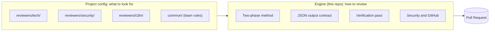

[← ReviewMe](../README.md) · **English** · [Français](fr/reviewers.md)

# Reviewers

## Method in the engine, knowledge in the config

ReviewMe keeps two things apart:

- **the engine (this repository)** knows *how* to review: the method, the output format,
  the verification pass, security, talking to GitHub. It is the same for every project;
- **a reviewer (a config folder)** knows *what* to look for in *this* project: its persona,
  its rules, when it runs. A team writes as many as it needs.



A project combines two kinds of reviewers, enabled in different ways:

| | Core reviewer | Custom reviewer |
|---|---|---|
| Defined | in the engine | in your repository, `reviewers/<name>/` |
| How to enable | its name in `core = [...]` in `project.toml` | its folder exists: nothing else to declare |
| How to disable | remove its name from the list | `enabled = false` in its `reviewer.toml` |
| Updates | follows the engine | yours |

Full example of a project using both:

```text
.reviewme/projects/shop/
├── project.toml              [reviewers] core = ["tech", "advisor"]
└── reviewers/
    └── security/             custom reviewer, active because the folder exists
        ├── reviewer.toml
        └── system.md
```

Three reviewers run on its PRs: `tech` and `advisor` (core), `security` (custom).

## Core reviewers: enable them by name

Shipped with the engine (`config/templates/reviewers/`), they follow its updates. Enable
them in the project's `project.toml`; removing a name disables it.

```toml
# .reviewme/projects/shop/project.toml
[reviewers]
core = ["tech", "advisor"]
```

| Name | Role | Output | Requires |
|---|---|---|---|
| `tech` | bugs, logic, security, repository conventions | inline | — |
| `us` | are the ticket's acceptance criteria covered? | one comment, silent when all are covered | Jira (`JIRA_BASE_URL`, `JIRA_EMAIL`, `JIRA_API_TOKEN`) |
| `i18n` | missing or doubtful translations | inline and summary | translation files in the PR (`*.strings`, `values*/strings.xml`…) |
| `advisor` | what a human must check themselves on this PR | one comment, silent when nothing applies | — |

**Adapt them without copying**: the project can tell a core reviewer where its docs
are, when to run and what it should know. Everything else (method, output, verification)
stays the engine's.

```toml
[reviewers.tech]
read = ["Documentation/ARCHITECTURE.md", "Documentation/"]   # added to what it reads
paths = ["src/**"]                                            # when it runs
instructions = "Business services live in src/services; no network calls from views."
# model = "…"   max_turns = 50   priority = 10   enabled = false
```

**Let an AI do it**: the [`skills/reviewme-create-reviewer`](../skills/reviewme-create-reviewer/SKILL.md)
skill guides Claude Code to explore the repository, choose between adapting a
core reviewer and creating one, write a short persona and validate the config. Copy it into
the project's `.claude/skills/`, then ask for instance "add a reviewer that checks our
migrations".

## Custom reviewers: a folder in the project

For what is specific to **your** code, a reviewer is a folder under
`.reviewme/projects/<project>/reviewers/<name>/`, in the reviewed repository (or in a
separate config repository, via `REVIEWME_CONFIG_HOME`). The name is free; a folder named
after a core reviewer replaces it for that project.

```text
.reviewme/projects/shop/
├── project.toml                 project settings (optional)
├── common/
│   └── team-rules.md            team rules, shared by every reviewer
└── reviewers/
    └── security/
        ├── reviewer.toml        when it runs, what it reads
        └── system.md            its persona: what it looks for in THIS project
```

```toml
# reviewers/security/reviewer.toml
output_mode = "inline"                 # inline | global | mixed
priority    = 10

[when]                                 # only runs when these files change
paths = ["src/api/**", "src/auth/**"]

[context]                              # read from the reviewed repo, never copied here
read = ["docs/security.md"]

```

```markdown
<!-- reviewers/security/system.md -->
# Shop security reviewer
You look for: routes without access control, SQL built by string concatenation,
hard-coded secrets, customer data written to logs. `@public` decorators are intentional.
```

The engine adds the method, the output format and the repository's instruction files
(`CLAUDE.md`, `AGENTS.md`, `.claude/rules/`) on its own. The persona stays short.
